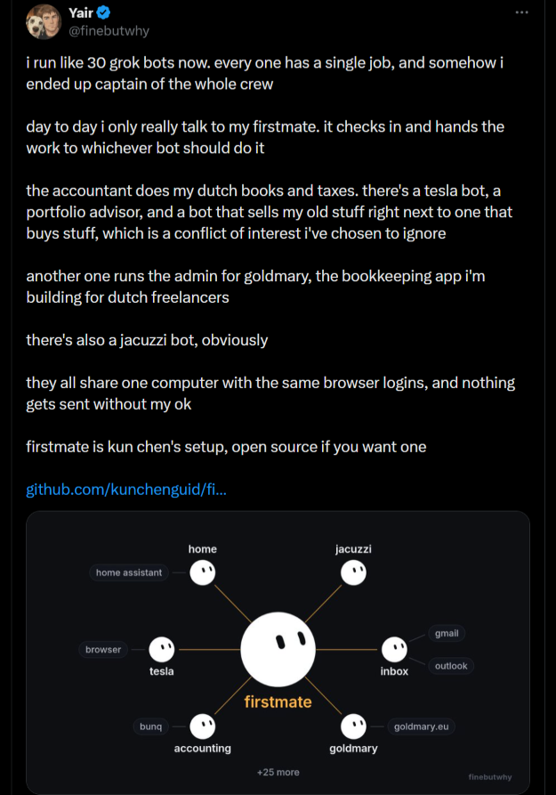
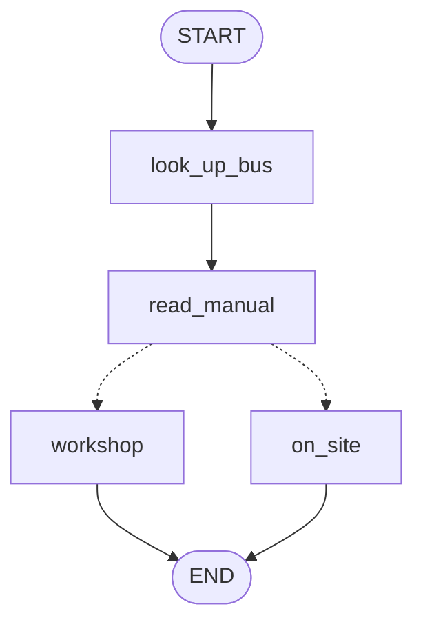

# A Crew of Thirty Agents

<div style="display:grid;grid-template-columns:1.5fr 1fr;gap:0 1.5em;align-items:start;">
<div>

- A personal setup, October 2026, built on the open-source `firstmate` distribution :
  - About 30 Grok agents, each with a single job
  - One first mate takes every request and hands it to the right agent
- The jobs include :
  - Dutch bookkeeping and taxes against a bunq account
  - An inbox over Gmail and Outlook, Home Assistant, a Tesla
  - The admin of his app goldmary.eu, a portfolio advisor
  - A seller and a buyer, side by side
- The agents share one computer and one set of browser logins
- "nothing gets sent without my ok"

</div>
<div>



</div>
</div>

<!-- NOTES:
Timing : Monday, straight after the preamble. The opening run of seven slides takes about 20 minutes ; it is the hook, not the content. Every example returns in module 10.
Yair is a friend of Feiko's, @finebutwhy on X, and agreed on 13 October 2026 to be quoted. firstmate : github.com/kunchenguid/firstmate, MIT.
Ask the participant which of these agents they would trust with their bank account, and why the one with the browser logins worries you most. Hold the answer ; it comes back in module 06 under least privilege.
The seller and the buyer serving one owner is the outline's conflict resolution, made concrete. Yair's words : "a conflict of interest i've chosen to ignore".
-->

---

# Ten Thousand Agents on Navier-Stokes

- OpenAI, 8 September 2026 : a proposed resolution of a Millennium Prize Problem :
  - A smooth fluid at rest, under a smooth force, develops a singularity in finite time
- Found by a system of coordinating agents on an unreleased internal model :
  - On the order of 10,000 concurrent agents in the group that found it
  - 88 hours to the proof, then 17 hours to formalise it in Lean
  - 2.7 million messages and about 130 billion output tokens
- Mathematicians are still examining it
- OpenAI does not claim the prize

<!-- NOTES:
Source : openai.com/index/navier-stokes-solution, 8 September 2026, updated 10 September. Quanta, 8 September : Sébastien Bubeck estimates the cost at several million dollars ; swyx on Latent Space puts it near 40 million at public API prices, his own estimate.
Priority on the forced Euler result goes to Levent Alpöge and Tristan Buckmaster ; OpenAI says its investigation found Buckmaster's Codex prompts could not have influenced the result. Do not litigate this in class ; say it is contested and move on.
The point for the room : the patterns this course teaches, at the largest scale anyone has published.
-->

---

# How the Swarm Was Organised

- Agents worked in groups and messaged only within their own group
- Separate groups received different variants of the problem :
  - Some aimed at a proof of smoothness, others at a blowup
- Codex merged the most useful findings of each group into new prompts
- Agents moved to Navier-Stokes after about 100 agents resolved a related Euler problem
- The model was replaced by a further-trained version during the run
- Lean checked the final proof :
  - The proof checker accepts no step that does not follow

<!-- NOTES:
All of this is from OpenAI's own page. It describes no recursion and no RLM ; the next slides are a different idea.
Map each line to the course as you go : groups are scoped communication (06), variants are parallel exploration and adversarial verification (05), Codex is a synthesiser over map-reduce (05, 06), moving agents is an orchestrator reallocating work, the model swap needs durable state (03, 07), Lean is a checker written in code (05).
-->

---

# A Research Team of Agents

- Anthropic, June 2025 : a lead agent that spawns parallel subagents for research :
  - Claude Opus 4 as the lead, Claude Sonnet 4 as the subagents
  - 90.2 % better than a single Opus 4 agent on Anthropic's internal research evaluation
- The cost, from the same report :
  - Agents use about 4 times the tokens of a chat ; multi-agent systems about 15 times
  - Token usage alone explained 80 % of the variance in performance
- A poor fit, from the same report :
  - Domains where every agent needs the same context
  - Most coding tasks, with fewer parallel parts than research

<!-- NOTES:
Source : anthropic.com/engineering/multi-agent-research-system, 13 June 2025. Old by AI standards and still the most cited case for and against multi-agent.
The 80 % line is the important one : much of the gain is spending more tokens. Ask whether a single agent given the same token budget would close the gap. Module 05 measures exactly that on our own question.
-->

---

# Recursive Language Models

- A model that treats a long input as an environment to explore in code :
  - The input sits in a Python REPL instead of the prompt
  - The model writes code that splits it and calls fresh copies of itself on the parts
  - Only the sub-calls use tools ; the root model sees their results
- Zhang, Kraska and Khattab, MIT, December 2025 :
  - Inputs about two orders of magnitude beyond the context window
- Prime Intellect called it the paradigm of 2026
- Alex Zhang : a harness whose only tool is code
- Deep Agents ships the idea as dynamic subagents

<!-- NOTES:
Sources : arxiv.org/abs/2512.24601 ; primeintellect.ai/blog/rlm, 1 January 2026 ; Latent Space, latent.space/p/rlm, 2 October 2026. Zhang's words : "a harness design where the only tool in the harness is code".
Zhang contrasts it with Claude Code, Codex and Pi, which he calls "trajectory as a prompt" : the whole history stays in the main model's context. An RLM keeps the history in code and hands out pieces.
Prime Intellect's own results : clear wins on very long inputs, a loss on maths, and a win on DeepDive only once the model was told how to split the work. Keep that for module 08.
-->

---

# The Bill for a Swarm

- Every extra agent reads context and writes messages
- Measured in this course on a two-part question, `gpt-6-luna` :
  - A single agent answered in 2 model calls ; each multi-agent pattern needed 4 to 6
  - A Deep Agent read 28 times the input tokens of the single agent
- Alex Zhang suspects most of a large swarm's work is wasted
- Cognition, June 2025 : parallel agents with partial context make conflicting decisions
- The LangChain docs : a single agent with the right tools often does as well

<!-- NOTES:
Measurements : build/measurements.md, 13 October 2026, three runs per pattern. Module 05 shows the full table, demo13.
Zhang on Latent Space : "Fairly certain that, like, 95% of the swarm is entirely useless". He added straight away that he was unsure it applied to the setup under discussion ; say so if you quote it.
Cognition : cognition.ai/blog/dont-build-multi-agents. LangChain : docs.langchain.com/oss/python/langchain/multi-agent.
The tension between the last four slides and this one is the course : when does the extra agent pay for itself?
-->

---

# Patterns Behind the Examples

| example | pattern | module |
| --- | --- | --- |
| a first mate and its crew | subagents behind one point of contact | 05 |
| groups that message only internally | scoped communication, hierarchical teams | 05, 06 |
| proof and disproof groups in parallel | parallel exploration, adversarial verification | 05 |
| Codex merging each group's findings | a synthesiser over map-reduce | 05, 06 |
| a seller and a buyer for one owner | conflict resolution | 06 |
| "nothing gets sent without my ok" | approval flows | 07 |
| Lean checking the proof | a checker written in code | 05, 07 |
| a recursive language model | dynamic subagents | 08 |

<!-- NOTES:
Close the opening here and move to what LangGraph is. Say that all three days build these patterns at a scale that fits a laptop and a ten-dollar key, and that module 10 returns to every example on this table.
-->

---

# What is LangGraph?

- LangGraph is a runtime for stateful workflows and agents :
  - Nodes do the work, such as a lookup, a model call or a whole agent
  - Edges fix which node may run next
- The runtime adds services for long-running work :
  - Checkpoints save state, so a stopped run resumes where it stopped
  - Interrupts pause a run until a person decides, such as approving a part order
  - Streaming shows progress and model output while the run continues
- LangChain agents and Deep Agents run on LangGraph
- One graph can mix fixed steps with model decisions

<!-- NOTES:
Timing : allow about 90 minutes for the full module, including the seven opening slides and four demos. The opening takes about 20 minutes. Estimates for delivery, not measured timings. At COURSE_RPS=0.08 demo01 is best shown from its saved outputs ; rerun one tool-list size live if time permits.
Source : https://docs.langchain.com/oss/python/concepts/products. LangGraph is described as both a low-level orchestration framework and a runtime ; the runtime role distinguishes the three layers here.
-->

---

# Runtime and Harness Layers

| layer | provides | package |
| --- | --- | --- |
| runtime | state, checkpoints, interrupts, streaming | LangGraph 1.2.15 |
| framework | model interfaces, tools, agent loop, middleware | LangChain 1.4.5 |
| harness | filesystem, delegation, context management | Deep Agents 0.7.24 |

- A framework supplies building blocks ; the application assembles them
- A harness supplies a ready agent, with tools and instructions around its loop
- The runtime leaves the most control to the application ; the harness the least

<!-- NOTES:
Source : https://docs.langchain.com/oss/python/concepts/products ; versions from build/research-2026-10.md section 2 and installed package metadata. Keep the overview separate from demo03, which measures these layers later. Planning is opt-in on this Deep Agents pin.
-->

---

# Agent Frameworks Overview

- Provider-led SDKs integrate with their ecosystems :
  - OpenAI Agents SDK, Google ADK and Claude Agent SDK
  - Support for other models varies by SDK and feature
- Model-agnostic frameworks span providers :
  - LangChain, CrewAI and Pydantic AI
  - LangGraph exposes the graph runtime directly
- Microsoft Agent Framework succeeds AutoGen and Semantic Kernel
- Two requirements decide the choice :
  - Who controls the flow, the code or the model
  - Where the agent runs and who operates it

<!-- NOTES:
Port : ARI510 01 Agent Frameworks Overview, preserving its provider-led and model-agnostic distinction. October versions are on the next slide. Sources : https://docs.langchain.com/oss/python/concepts/products ; https://learn.microsoft.com/en-us/agent-framework/overview/agent-framework-overview ; ARI510 September survey and ARI520 October survey.
-->

---

# Framework Capabilities

| package | version | main abstraction |
| --- | --- | --- |
| CrewAI | 1.15.27 | agents, crews, tasks and flows |
| OpenAI Agents SDK | 0.23.1 | agent loop, tools and handoffs |
| Google ADK | 2.12.0 | agents and workflow composition |
| Microsoft Agent Framework | 1.21.0 | agents and graph workflows |
| Claude Agent SDK | 0.2.165 | Claude Code harness as an SDK |
| Pydantic AI | 2.55.0 | typed dependencies and validated output |

- LangGraph needs no agent loop ; a graph of plain Python functions runs as it is

<!-- NOTES:
Skippable. Port : ARI510 01 framework slides condensed into a landscape comparison for a LangGraph course. Versions are the PyPI snapshot of 13 October 2026 in build/research-2026-10.md section 2, not a promise of the latest release at delivery. Sources : https://docs.crewai.com/ ; https://openai.github.io/openai-agents-python/ ; https://google.github.io/adk-docs/ ; https://learn.microsoft.com/en-us/agent-framework/ ; https://platform.claude.com/docs/en/agent-sdk/overview ; https://ai.pydantic.dev/ . Competing packages are not installed or benchmarked in this module.
-->

---

# LangGraph Control Flow

- LangGraph starts from state and transitions :
  - A node runs a function, a model call or a whole agent
  - The graph fixes which node may follow which
- Agent SDKs start from an agent loop and its tools
- Other frameworks add explicit flows next to the loop :
  - CrewAI provides Flows
  - ADK and Microsoft Agent Framework provide workflow composition
- `create_agent` supplies a standard loop for an agent that needs no custom graph

<!-- NOTES:
Port : ARI510 01 Framework Choice and 08 LangChain vs. LangGraph. Sources : https://docs.langchain.com/oss/python/concepts/products ; https://docs.crewai.com/en/concepts/flows ; https://adk.dev/ ; https://learn.microsoft.com/en-us/agent-framework/overview/. Do not imply that LangGraph is the only framework with graphs, persistence or deterministic workflow steps.
-->

---

# Model APIs and Agent Runtimes

| interface | who runs the tool loop | role |
| --- | --- | --- |
| Chat Completions | application | course OpenRouter model endpoint |
| Responses API | application, with hosted tools available | OpenAI model interface |
| Agents SDK | SDK in the application | agent loop, handoffs and tracing |
| Managed Deep Agents | provider-hosted harness | hosted sessions and execution |

- OpenAI-compatible names an API shape ; each provider supports its own subset
- A model only requests a tool call ; the runtime executes it and returns the result
- LangGraph keeps the application's state between model calls

<!-- NOTES:
Port : ARI510 02 Model APIs and Agent Runtimes, found in module 02 rather than the specified module 01. Keep its table distinction and update the course endpoint to OpenRouter. The hosted row uses Managed Deep Agents from the October research rather than ARI510's Managed Agents API. Sources : ARI510 build/currency-audit-2026-09-18.md ; build/research-2026-10.md section 3 ; https://docs.langchain.com/oss/python/concepts/products. Managed Deep Agents is a separate beta service ; no hosted runtime is used in the notebooks.
-->

---

# Why Multi-Agent?

- A second agent gives a task its own context :
  - The parts agent sees stock tools ; the manuals agent sees repair procedures
  - Each worker returns only its result to the orchestrator
- Distributed development lets separate teams own separate agents
- Parallelism runs independent lookups, such as stock and manuals, at the same time
- LangChain documents three reasons to split :
  - Too many tools cause poor tool selection
  - Specialised knowledge takes up extensive context
  - Sequential constraints unlock tools in stages, such as triage before repair advice

<!-- NOTES:
Source : https://docs.langchain.com/oss/python/langchain/multi-agent/index. Distinguish the three motivations from the three concrete reasons. Sequential constraints can also be enforced by a fixed workflow or by changing the tools of one agent.
-->

---

# Context Engineering

- Context engineering determines which information each agent sees :
  - Subagents : each worker sees the task the supervisor wrote
  - Handoffs : the next specialist receives transferred state and history
  - Skills : one agent loads specialised prompts on demand
  - Router : each agent sees the part of the input routed to it
- Veenhaven Bus specialists receive the identifiers and tools needed for their task
- Modules 05 and 06 compare calls and tokens across patterns

<!-- NOTES:
Source : https://docs.langchain.com/oss/python/langchain/multi-agent/index, read 14 October 2026. The docs' sentence : "At the center of multi-agent design is context engineering", then after a dash, "deciding what information each agent sees".
Source for the Veenhaven Bus examples and cost comparison : build/measurements-01.md, demo02 ; build/measurements.md ; build/plan.md, modules 05 and 06.
This is the first idea of the course's thesis. Come back to it in every pattern : what does each agent see?
-->

---

# One Agent with More Tools

- One agent with the right tools is the baseline every split is measured against
- Every tool description travels with every model call
- The Veenhaven Bus probe adds tools for unrelated company systems :
  - Eight repair tools and six questions stay the same
  - The added tools return no records
- Input tokens per call grow from 555 at 8 tools to 1,669 at 60
- The saved run misses one expected fact at 40 tools and none at 60
- No distractor tool is called in the saved run

> `demo01 · one-agent-limits`

<!-- NOTES:
Source : demo01-one-agent-limits ; build/measurements-01.md. This probes tool selection with inert distractors, not the quality of a complete company-wide tool suite. Read the answers as well as the text-match scores. Do not describe a limit unless the run shows one.
Measured 14 October 2026 on gpt-6-luna : 8/20/40/60 tools score 6/6, 6/6, 5/6, 6/6 on expected facts. Input tokens are 8,335 / 14,868 / 19,038 / 26,719. No monotonic correctness threshold. The region-Zuid question is misread as a fleet lookup at every size ; at 40 tools it omits Nora Dalen. At 20 and 40 tools the historical-ticket answer labels RR-BP-03 as a door controller, although the part is an auxiliary battery pack. The fact check accepts its part number and does not catch the label. These are separate answer-quality findings, not evidence that irrelevant tools were selected.
-->

---

# When One Agent is Enough

- The LangChain docs warn before they teach the patterns :
  - "a single agent with the right (sometimes dynamic) tools and prompt can often achieve similar results"
- One agent suits a task whose context fits and whose tools it picks correctly
- Dynamic tool loading keeps one agent's tool list short
- A fixed process fits a workflow, with model calls only where judgment is needed
- A second agent adds model calls ; the course probe measured 2 for one agent, 4 to 6 per pattern
- A split needs a measured failure that one agent cannot fix
- Independent tasks with distinct context are the case worth testing

<!-- NOTES:
Sources : https://docs.langchain.com/oss/python/langchain/multi-agent/index ; https://cognition.ai/blog/dont-build-multi-agents ; build/measurements.md. Cognition's warning concerns lost context and conflicting implicit decisions. Avoid treating it as a universal rejection of isolated workers.
-->

---

# Graph-Based Architecture

- A state graph runs steps over one shared state, such as a bus report and its lookups
- Each node receives the state and returns the keys it changed
- Edges define execution order :
  - Fixed edges select a known next step
  - Conditional edges choose from state, such as workshop or on-site repair
- A cycle lets a step run again, such as a retry
- `compile` turns the definition into a graph that runs
- `START` and `END` mark the entry and the exit

<!-- NOTES:
Port : ARI510 08 LangGraph Concepts and Thinking in LangGraph. Source : https://docs.langchain.com/oss/python/langgraph/graph-api. Keep this at overview level ; module 02 takes every part apart.
-->

---

# Conditional Routing

<div style="display:grid;grid-template-columns:1.2fr 1fr;gap:0 1.5em;align-items:start;">
<div>

- A routing function reads the state and returns the next node's name
- `Literal` in the return type names the possible targets
- The graph diagram shows a dashed edge to each possible target

```python
def route(state: Report) -> Literal["workshop", "on_site"]:
    return "workshop" if "workshop" in state["action"] else "on_site"
```

</div>
<div>



</div>
</div>

<!-- NOTES:
Sources : demo02 a ; build/measurements-01.md, demo02 results ; https://docs.langchain.com/oss/python/langgraph/graph-api.
The diagram is the graph from demo02 a ; draw_mermaid prints the same shape with dashed conditional edges. F-CD-202's action mentions a workshop bay, so that report routes to the workshop ; F-CE-305 routes on site.
-->

---

# A First Graph

```python
builder = StateGraph(Report)
builder.add_node("look_up_bus", look_up_bus)
builder.add_node("read_manual", read_manual)
builder.add_node("workshop", lambda state: {"where": "workshop"})
builder.add_node("on_site", lambda state: {"where": "on site"})
builder.add_edge(START, "look_up_bus")
builder.add_edge("look_up_bus", "read_manual")
builder.add_conditional_edges("read_manual", route)
builder.add_edge("workshop", END)
builder.add_edge("on_site", END)
graph = builder.compile()
```

- The graph uses deterministic bus lookups and state updates, with no model call
- A node returns only the keys it changes, and LangGraph merges them into the state

> `demo02 · first-look`

<!-- NOTES:
Sources : build/measurements-01.md, demo02 ; https://docs.langchain.com/oss/python/langgraph/graph-api ; demo02 a, which also streams one run node by node. Ask what changes when read_manual becomes a model call : nothing in the wiring.
-->

---

# A First Multi-Agent System

- A supervisor exposes specialists as tools :
  - A manuals agent reads procedures
  - A parts agent checks stock
- Each specialist receives the supervisor's task in a fresh conversation
- The supervisor writes the final answer from the specialists' tool results
- Both specialists use the same model ; neither sees the other's conversation
- The first saved run read fault code F-CE-110 as a part number
- The fix gives the parts agent `bus_info` and rules for fleet numbers and part numbers

> `demo02b · first-multi-agent`

<!-- NOTES:
Source : demo02 b ; https://docs.langchain.com/oss/python/langchain/multi-agent/subagents. The callback meter includes nested agent calls. The supervisor may delegate sequentially because the part number depends on the manual lookup. No speedup is claimed. The first execution failed its fact check because the parts agent confused a fault code with a part number. The corrected parts agent can resolve the fleet number through bus_info and receives explicit identifier instructions. This is a tool/context boundary problem, not an exception from the graph runtime.
-->

---

# A StateGraph by Hand

- The application defines the path for one bus diagnosis :
  - A model extracts the fleet number and error code
  - Python looks up the bus, manual and spare part
  - A model writes the answer from those facts
- State stores the extracted fields, facts and answer
- Code decides which lookups run and in what order
- The saved run makes 2 model calls, one to extract and one to answer

> `demo03 · three-levels`

<!-- NOTES:
Source : demo03 a ; build/measurements-01.md. This is a fixed graph with model steps, not a hand-written tool-calling loop. The comparison concerns levels of application control on the same task, not identical execution paths.
-->

---

# create_agent

- `create_agent` builds a tool-calling loop on LangGraph
- The model receives the prompt and tool schemas
- Each tool result goes back to the model for its next step
- The model decides which lookups to run and when to answer
- The bus question and the service desk tools are the same as in the graph by hand
- The saved run takes 4 model calls against 2 for the graph by hand
- The compiled graph exposes its nodes and edges

> `demo03b · create-agent`

<!-- NOTES:
Source : demo03 b ; installed langchain 1.4.5 create_agent signature ; https://docs.langchain.com/oss/python/langchain/agents. The graph-by-hand example performs database lookups in code ; the agent chooses tools, so calls and correctness can differ.
-->

---

# create_deep_agent

- `create_deep_agent` adds a harness around the agent loop :
  - Filesystem tools support context offloading
  - A general-purpose subagent supports delegation
  - Summarisation manages conversation history
- The service desk prompt and tools stay the same
- Built-in tool descriptions raise input tokens from 1,962 to 9,732 on the bus question
- Todo planning is opt-in in version 0.7.24

> `demo03c · deep-agent`

<!-- NOTES:
Source : demo03 c ; installed deepagents 0.7.24 source. The default backend is virtual state storage, not a host shell. execute is offered but returns an error on a non-sandbox backend. No todo middleware is added for this comparison. Read the printed calls and tokens without promising a fixed ratio.
Saved run, 14 October 2026 : the hand-written graph, create_agent and create_deep_agent all answer correctly. Calls are 2 / 4 / 4 ; input tokens 216 / 1,962 / 9,732. The two agents use the same three service desk tools ; the Deep Agent's additional tools are unused. See build/measurements-01.md. This measures overhead on a short task, not long-task quality.
-->

---

# Three Levels Compared

| level | who picks the steps | calls | input tokens | expected facts |
| --- | --- | --- | --- | --- |
| `StateGraph` by hand | the code | 2 | 216 | pass |
| `create_agent` | the model | 4 | 1,962 | pass |
| `create_deep_agent` | the model, inside a harness | 4 | 9,732 | pass |

- One run each on `gpt-6-luna`, 14 October 2026, on the F-MM-210 question
- All three identify MM-BT-02 as the auxiliary battery with zero stock
- Code fixes the graph's lookup sequence
- Both agents chose the same three tools ; the harness tools stayed unused
- Module 08 compares the harness on a longer task

<!-- NOTES:
Source : build/measurements-01.md, demo03. Single runs, not medians ; no general reliability or cost ratio follows. Source for the module 08 comparison : build/plan.md, module 08. Ask which level the participant would ship for this question, and which for "plan the maintenance of every MM-09 in the fleet".
-->

---

# Agents versus Workflows

- A workflow follows paths defined in code :
  - Branches and loops have explicit conditions
  - Model calls can handle selected steps
- An agent chooses its next action from available tools :
  - The model decides the lookup sequence
  - The model decides when it has enough information
- Both receive the same four bus reports
- A fixed bus workflow escalates a report without an error code
- An agent can search the manuals by symptom instead
- Production systems often combine fixed and agentic steps

> `demo04 · workflow-or-agent`

<!-- NOTES:
Port : ARI510 01 Agents versus Workflows and demo01's tool-choice comparison, adapted to the bus reports. Source : demo04 ; https://docs.langchain.com/oss/python/langgraph/workflows-agents. The fixed workflow and agent receive the same four reports. The workflow's missing-code branch deliberately escalates ; an agent's wider search can succeed or fail.
-->

---

# What Survived in 2026

- The design that held up in practice is an orchestrator with isolated workers :
  - One agent owns the task and combines results
  - Each worker receives a bounded brief and its own context
- `firstmate` implements this shape around coding harnesses :
  - Each task has its own git worktree and session
  - A watcher wakes the orchestrator on events
  - Briefs and state persist in files
- Each worker's result still goes through review before it is merged

<!-- NOTES:
Sources : https://github.com/kunchenguid/firstmate ; build/research-2026-10.md section 5. This is a design seen in practice, not a measured market-share claim. Yair's crew in the opening is a personal-agent use ; his coding fleet uses worktrees and a review pipeline. No claim that every competing design disappeared. The repository's nautical labels are project names, not an analogy for LangGraph.
-->

---

# The firstmate Orchestrator

- `firstmate` supplies instructions, skills, scripts and persistent state for coding harnesses
- The MIT-licensed project supports Claude Code, Codex and Pi

| `firstmate` | in this course |
| --- | --- |
| a first mate dispatching to crewmates | subagents behind one orchestrator, module 05 |
| one git worktree and session per task | context isolation and backends, module 08 |
| a watcher that wakes the first mate on events | event systems and async subagents, modules 06 and 09 |
| briefs and state files on disk | checkpointers and the `Store`, module 03 |
| merges escalated to the human | interrupts and approval flows, module 07 |

- Yair reports using `firstmate` for his coding fleet

<!-- NOTES:
Source : https://github.com/kunchenguid/firstmate, about 7.9K stars on 13 October 2026. Mapping from build/research-2026-10.md section 5.
The orchestrator shape built from processes and files instead of a graph. Feiko shows it live in module 10 ; here it only needs to be recognised as the same shape.
-->

---

# The Service Desk Case

- Aurelia Imaging Systems is a fictional imaging-equipment manufacturer
- The capstone builds a service desk over its supplied data :
  - Manuals and service bulletins
  - Parts, equipment and service records in SQLite
  - Tickets and an evaluation set
- Specialists handle manuals, parts and scheduling
- Part orders pause for approval
- The demos run on a second fictional company, Veenhaven Bus :
  - 10 buses at 5 depots, 13 parts, 31 manuals and 43 tickets

<!-- NOTES:
Source : build/plan.md, capstone section ; data/capstone and data/demo-world. Both companies and their datasets are fictional. No capstone records are used in the demo notebooks. Present the capstone as service support, not clinical decision-making.
-->

---

# The Capstone in Five Stages

| stage | after | Aurelia service desk |
| --- | --- | --- |
| 1 | module 03 | triage, a `service.db` lookup and an answer ; typed state and a checkpointer |
| 2 | module 05 | specialists for parts, manuals and scheduling behind a supervisor |
| 3 | module 07 | parallel diagnosis with a judge ; the manuals agent over A2A ; part-order approval inside a subagent |
| 4 | module 08 | the same desk as a Deep Agent, compared with stage 3 |
| 5 | module 09 | serving with `langgraph dev`, an async diagnosis subagent and per-agent evaluation |

- Evaluation compares answer quality, model calls and tokens as the desk gains capabilities

<!-- NOTES:
Source : build/plan.md, the capstone. Stage 1 starts Monday afternoon. Present the capstone as service support, not clinical decision-making.
-->

---

# The Three Days

| day | modules | builds |
| --- | --- | --- |
| Monday | 01 to 04 | graphs, state and single agents from LangGraph primitives |
| Tuesday | 05 to 07 | the multi-agent patterns, communication between agents, control |
| Wednesday | 08 to 10 | the same system as a Deep Agent, then served, evaluated and applied |

- Three ideas run through every module :
  - Multi-agent is context engineering
  - One agent first ; add an agent when a measurement says so
  - Build each pattern by hand, then use the harness

<!-- NOTES:
Source : build/plan.md, the days and the thesis. Delivery dates are 2 to 4 November 2026 ; the generated course schedule stays separate. Tuesday is the densest day ; its cut order is in the plan. Pivot for a participant without LangChain : lengthen 04, shorten 02 and 03.
-->

---

# Summary : Introduction to LangGraph

- LangGraph runs stateful workflows and agents
- LangChain supplies agent abstractions ; Deep Agents supplies a harness
- State, nodes and edges make control flow explicit
- Workflows fix paths ; agents choose actions through tools
- Multi-agent design decides what each agent sees
- One agent sets the baseline for quality and cost
- Isolated workers suit tasks with distinct context needs
- A measurement decides whether a second agent pays for itself
