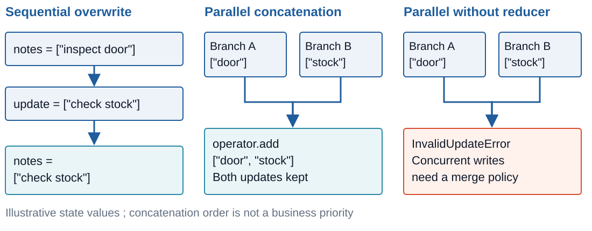
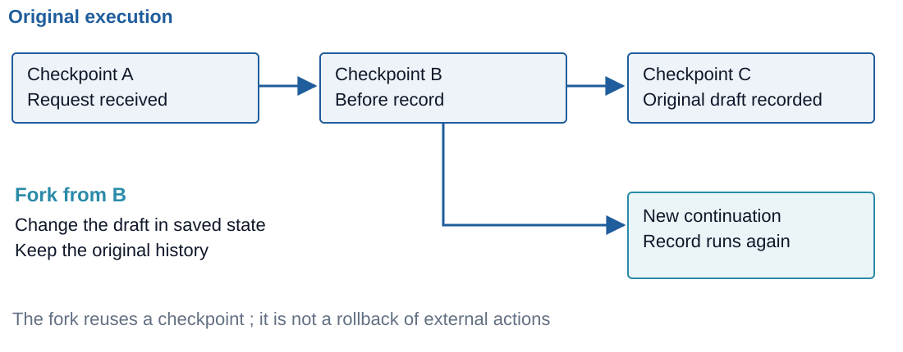

# TypedDict State

- A state schema names the keys shared between nodes
- `TypedDict` describes dictionary fields for type checking
- Nodes return partial updates ; omitted keys retain their values

```python
class TicketState(TypedDict):
    ticket_id: str
    symptom: str
    status: str

def mark_open(state: TicketState):
    return {"status": "open"}
```

- `TypedDict` annotations are not checked at runtime ; a wrong type passes

> `demo01 · typed-dict`

<!-- NOTES:
Timing : Monday afternoon, allow about 75 minutes including the demos. If the participant knows LangGraph, keep reducers, concurrent updates, restoration and forking ; skim schemas and stream formats.
Source : https://docs.langchain.com/oss/python/langgraph/graph-api ; installed langgraph 1.2.15, demo01. The class and node are the notebook definitions. No course overview slide is needed.
-->

---

# Dataclass State

- A dataclass supplies defaults for fields omitted from input
- Nodes receive a dataclass instance and return dictionary updates

```python
@dataclass
class TicketDefaults:
    ticket_id: str
    status: str = "new"

def inspect_default(state: TicketDefaults):
    return {"status": "open"}
```

- Attribute access uses `state.status`
- Dataclass annotations do not enforce field types

<!-- NOTES:
Source : https://docs.langchain.com/oss/python/langgraph/graph-api ; demo01 a includes the default and prints the node input. Skippable.
-->

---

# Pydantic State

- Pydantic validates state when it is constructed for a node
- Field constraints reject invalid input before the node runs

```python
class ValidatedTicket(BaseModel):
    ticket_id: str
    hours: float = Field(ge=0)

def round_hours(state: ValidatedTicket):
    return {"hours": round(state.hours, 1)}
```

- A node that returns `hours=-1` passes unchecked ; only node input is validated
- Validation adds runtime work compared with `TypedDict`

> `demo01b · pydantic`

<!-- NOTES:
Source : https://docs.langchain.com/oss/python/langgraph/graph-api ; demo01 b rejects hours=-1 as node input, but a final node returning hours=-1 succeeds. Do not present Pydantic as validation of every state write.
-->

---

# Input and Output Schemas

- The internal schema contains the graph's working state
- `input_schema` selects the fields accepted at entry
- `output_schema` selects the fields returned by `invoke`

```python
public = StateGraph(
    InternalState,
    input_schema=TicketInput,
    output_schema=StatusOutput,
)
```

- A ticket id enters ; only the resulting status leaves
- The filtered keys remain in the checkpoints

> `demo01c · input-and-output`

<!-- NOTES:
Source : https://docs.langchain.com/oss/python/langgraph/graph-api#multiple-schemas ; demo01 c. Filters are graph interfaces, not a data retention policy.
-->

---

# Private State

- Nodes can declare additional channels through their input schemas
- A private schema carries internal communication between nodes

```python
class PrivateState(TypedDict):
    working_note: str

def finish(state: PrivateState):
    return {"status": state["working_note"] + " at depot"}
```

- Private channels can be excluded from the graph's public output
- `working_note` still appears in checkpoints and in the `values` stream
- Hiding a key from the output gives no access control

> `demo01d · private-state`

<!-- NOTES:
Source : https://docs.langchain.com/oss/python/langgraph/graph-api#multiple-schemas ; demo01 d. The notebook's prepare node writes working_note ; finish's annotated input registers its channel. values streaming reveals it on 1.2.15.
-->

---

# Reducers

- A reducer is the merge policy for one key of the state
- Without a reducer, a sequential update overwrites the old value
- `Annotated` attaches a reducer to a field

```python
class Collect(TypedDict):
    collected: Annotated[list[str], operator.add]
    last: str
```

- `operator.add` concatenates the incoming list with the saved list
- Nodes return new entries for reduced keys
- Returning the accumulated list again can duplicate entries

<!-- NOTES:
Port : ARI510 08 Reducers and demo20. Source : https://docs.langchain.com/oss/python/langgraph/graph-api#reducers ; demo02 b. Keep the original tiny a/b example before the workshop findings. The original rhetorical bullet has been made declarative.
-->

---

# Merging State Updates



- Each state key has its own reducer, or none
- A reducer defines how updates to that key combine
- Two workers that disagree both land in the list ; choosing one needs a judge or a review

<!-- NOTES:
Port : ARI510 08 Merging State Updates and its state-reducers.svg, copied without changing the source repository. Behaviour checked in demo02 b and d. The diagram's ordering is illustrative.
-->

---

# MessagesState

- `MessagesState` supplies a `messages` field with `add_messages`
- Additional fields extend the schema through inheritance

```python
from langgraph.graph import MessagesState

class ServiceState(MessagesState):
    depot: str
```

- A node can return only its new assistant message
- The reducer preserves earlier messages
- The depot field keeps the default overwrite policy

<!-- NOTES:
Port : ARI510 08 MessagesState. Source : https://docs.langchain.com/oss/python/langgraph/graph-api#messagesstate ; demo02 a.
-->

---

# add_messages

- `add_messages` manages message identities :
  - New ids append messages
  - Existing ids replace the corresponding entries
  - `RemoveMessage(id=...)` removes a matching entry

```python
history = add_messages(history, [
    AIMessage("Assigned to workshop", id="reply")
])
history = add_messages(history, [RemoveMessage(id="request")])
```

- Message dictionaries and role-content tuples become message objects
- Stable ids allow an application to edit an earlier message

> `demo02 · add-messages`

<!-- NOTES:
Port : ARI510 08 MessagesState and demo20's message replacement/removal example. Source : langgraph.graph.message.add_messages on 1.2.15 ; demo02 a.
-->

---

# Custom Reducers

- A custom reducer receives the current value and an incoming update
- The return value becomes the next value of that state key

```python
def merge_findings(current: list[str], incoming: list[str]):
    return sorted(set(current) | set(incoming))

class Findings(TypedDict):
    findings: Annotated[list[str], merge_findings]
```

- Set union removes duplicate findings in this example
- Sorting gives a stable presentation order
- Reducers should avoid mutating their arguments

> `demo02b · custom-reducers`

<!-- NOTES:
Source : https://docs.langchain.com/oss/python/langgraph/graph-api#custom-reducers ; demo02 b. This reducer is associative, commutative and idempotent for string findings. Those properties are useful design choices, not a claim that all LangGraph reducers must be commutative.
-->

---

# Overwriting a Reduced Key

- An ordinary update still goes through the reducer
- An empty incoming list does not clear a concatenated list
- `Overwrite` bypasses the reducer for a replacement

```python
from langgraph.types import Overwrite

reset.add_node("clear", lambda state: {
    "findings": Overwrite(value=[])
})
```

- The replacement can be a new value or the field's empty value
- Multiple overwrites of the same key in one step are invalid

> `demo02c · overwriting`

<!-- NOTES:
Source : https://docs.langchain.com/oss/python/langgraph/graph-api#overwrite ; installed langgraph.types.Overwrite and BinaryOperatorAggregate.update ; demo02 c verifies the clear. Multiple Overwrite values are checked in the implementation and the module API probe recorded in measurements-03.md.
-->

---

# Concurrent Updates

- Parallel nodes read the state available at the start of a superstep
- Their updates merge after that step's nodes complete
- Two writes to one unreduced key raise `InvalidUpdateError`

```python
parallel.add_edge(START, "parts")
parallel.add_edge(START, "workshop")
```

- A reducer lets both branches add their workshop findings to one key
- Separate keys suit branches that produce different results
- A reducer keeps both findings ; picking the correct one is a separate step

> `demo02d · concurrent-updates`

<!-- NOTES:
Port : ARI510 demo20's NoReducer example, followed by the reducer fix. Source : https://docs.langchain.com/oss/python/langgraph/graph-api ; demo02 d prints InvalidUpdateError and the fixed merged findings.
-->

---

# Checkpointers and Persistence

- A checkpointer saves execution state at superstep boundaries :
  - State values and the nodes scheduled next
  - Metadata and the config that identifies the checkpoint
- Checkpoints support memory between invocations and saved pauses
- Persistent storage allows restoration after a process restart

```python
from langgraph.checkpoint.memory import InMemorySaver

graph = builder.compile(checkpointer=InMemorySaver())
```

- `InMemorySaver` loses its checkpoints when the process ends

<!-- NOTES:
Port : ARI510 08 Checkpointers and Persistence. Source : https://docs.langchain.com/oss/python/langgraph/persistence ; demo03. Pending writes from successful tasks are a finer-grained recovery mechanism, covered with failures in module 07.
-->

---

# Threads

- `thread_id` identifies one sequence of saved graph states
- Reusing the id loads that thread's state before applying new input
- A different id starts a separate history

```python
morning = {"configurable": {"thread_id": "u1-morning"}}
graph.invoke({"messages": [("user", "My bus is 4012.")]}, morning)
graph.invoke({"messages": [("user", "Which bus?")]}, morning)
```

- Messages accumulate through their reducer across invocations
- The same thread recalls bus 4012 and depot Noord ; a new thread does not
- A thread id is not authentication ; the application decides who may read it
- One user can own many threads, such as `u1-morning`

> `demo03 · threads`

<!-- NOTES:
Port : ARI510 07 Short-Term Memory and 08 Checkpointers and Persistence. Source : https://docs.langchain.com/oss/python/langgraph/persistence ; demo03 a. Same-thread and new-thread model replies are inspected along with the checkpoint. Thread identifiers are not authentication.
-->

---

# SqliteSaver

- `langgraph-checkpoint-sqlite` supplies `SqliteSaver`
- A file-backed saver keeps checkpoints after the connection closes
- The context manager owns the connection lifetime

```python
from langgraph.checkpoint.sqlite import SqliteSaver

with SqliteSaver.from_conn_string(str(database)) as saver:
    persistent = builder.compile(checkpointer=saver)
    persistent.invoke(inputs, config)
```

- Graph calls that use the saver belong inside the `with` block
- SQLite suits local development and small applications

> `demo03b · sqlite-saver`

<!-- NOTES:
Port : ARI510 demo22 Surviving a restart. Source : installed langgraph.checkpoint.sqlite.SqliteSaver ; demo03 b. The database lives in notebooks/03-state-management/module03.db and is ignored by notebooks/**/*.db. Each execution uses a fresh thread id and leaves existing threads intact.
-->

---

# PostgreSQL Checkpoint Storage

- `langgraph-checkpoint-postgres` provides a PostgreSQL backend
- Several application processes can share one PostgreSQL checkpoint store
- Production operation includes :
  - Connection management and schema setup
  - Backups and checkpoint retention
  - Access controls for thread data
- The checkpointer persists execution state within a thread
- Cross-thread application memory uses a Store

<!-- NOTES:
Skippable. Slide only, as requested. Source : https://docs.langchain.com/oss/python/langgraph/persistence and the linked checkpointer guide. The PostgreSQL integration is not installed in the course environment and no database is available. No PostgreSQL API code is taught or claimed to be executed ; do not install packages or change the shared pins from this module.
-->

---

# Inspecting Thread State

- `get_state` returns a `StateSnapshot` for the selected checkpoint

```python
snapshot = graph.get_state(morning)
print(snapshot.values)
print(snapshot.next)
print(snapshot.config["configurable"]["checkpoint_id"])
```

- `values` contains the saved channel values
- `next` names nodes scheduled to run from that checkpoint
- An empty `next` indicates no scheduled continuation
- A config with `checkpoint_id` selects a historical snapshot

<!-- NOTES:
Port : ARI510 07 Inspecting Thread State. Source : installed Pregel.get_state and langgraph.types.StateSnapshot ; demo03 a and demo04. Snapshot tasks carry errors and interrupt details ; get_state itself does not run a node.
-->

---

# State History

- `get_state_history` yields saved checkpoints, newest first
- Each snapshot keeps its own config and parent relationship

```python
history = list(graph.get_state_history(config))
for snapshot in history:
    print(snapshot.metadata["step"], snapshot.next)

before_record = next(
    snapshot for snapshot in history
    if snapshot.next == ("record",)
)
```

- A snapshot's config selects the point for replay or forking

> `demo04 · state-history`

<!-- NOTES:
Port : ARI510 08 Time Travel and demo22 History and time travel. Source : https://docs.langchain.com/oss/python/langgraph/use-time-travel ; demo04 a. Keep the history selected before any replay changes the thread's latest checkpoint.
-->

---

# Restoring Saved State

- A new graph instance can load checkpoints from the same backend
- Restoration requires the same thread id and compatible graph code
- `invoke(None, config)` continues from the saved scheduled nodes

```python
with SqliteSaver.from_conn_string(str(database)) as saver:
    restored = builder.compile(checkpointer=saver)
    print(restored.get_state(config).next)
    restored.invoke(None, config)
```

- Supplying new input applies a new input update
- The demo closes the connection, compiles a new graph and runs `record` from the saved pause

<!-- NOTES:
Port : ARI510 demo22 Surviving a restart. demo03 b pauses after answer through interrupt_after, closes the connection and recompiles without the breakpoint. record runs on restoration. Dynamic interrupt and Command(resume=...) belong to module 07 ; None is correct for this static saved pause.
-->

---

# Time Travel

- Replay continues execution from a historical checkpoint
- Nodes before the checkpoint retain their saved results
- Nodes scheduled after it execute again

```python
replayed = graph.invoke(None, before_draft.config)
```

- Replaying from before `draft` calls the model again ; the wording can change
- A replayed part order can be placed a second time
- A checkpoint with no scheduled nodes has no continuation to replay
- Reading state with `get_state` does not replay execution

> `demo04b · replay`

<!-- NOTES:
Port : ARI510 08 Time Travel, separated from the fork so replay's model call is visible. Source : https://docs.langchain.com/oss/python/langgraph/use-time-travel ; demo04 b. The notebook prints model call counts and retains the original final checkpoint config.
-->

---

# Forking a Checkpoint

- `update_state` writes a new checkpoint from a saved one
- Updates pass through the same reducers as node updates
- `as_node` attributes the update and determines the continuation



- The original checkpoint remains addressable
- A fork does not cancel a part order the earlier run already placed

> `demo04c · forking`

<!-- NOTES:
Port : ARI510 08 Forking a Checkpoint, its checkpoint-fork.svg with review renamed to record, and demo22's draft edit. Source : https://docs.langchain.com/oss/python/langgraph/use-time-travel ; installed Pregel.update_state ; demo04 c. Supplying as_node explicitly avoids ambiguity after parallel writes. The new continuation is in the same thread, with a new checkpoint id. Continue it with graph.invoke(None, forked), as in the notebook.
-->

---

# DeltaChannel

- `DeltaChannel` is beta in LangGraph 1.2.15
- Saved writes reconstruct a growing value between periodic snapshots
- A delta reducer receives the accumulated value and a batch of writes

```python
def merge_batches(current, writes):
    return current + [item for batch in writes for item in batch]

class LongThread(TypedDict):
    entries: Annotated[list[str], DeltaChannel(merge_batches)]
```

- Reducers must be deterministic and invariant to batching
- Replay and snapshot storage depend on checkpointer support
- Delta storage does not shorten the model's context

<!-- NOTES:
Skippable. Source : installed langgraph.channels.delta.DeltaChannel docstring on 1.2.15 ; demo04's final probe reconstructs current state and checkpoint history. Unlike an ordinary reducer, the second argument is a sequence of writes. The beta API and on-disk representation may change. No storage savings benchmark is claimed.
-->

---

# Long-Term Memory

- A Store keeps application data across threads
- Namespace tuples group documents ; keys identify individual documents

```python
store = InMemoryStore()
namespace = ("users", "u1", "profile")
store.put(namespace, "depot", {"text": "depot: Noord"})
print(store.get(namespace, "depot").value)
```

- `put` with the same namespace and key replaces the document
- `search` retrieves items within a namespace prefix
- `delete` removes a document
- `runtime.store` and trusted runtime context scope a node's access

> `demo05 · the-store`

<!-- NOTES:
Port : ARI510 07 Long-Term Memory, Memory Tools and Profile and Collection Memory ; demo18 namespace/key and profile operations. Source : installed InMemoryStore and Runtime ; demo05. Plain search supports metadata filters but does not rank by meaning without an index. InMemoryStore loses data when the process ends. Application authentication and authorisation must enforce namespace access ; a namespace tuple alone does not isolate malicious callers.
-->

---

# Streaming Modes

- `stream_mode` chooses what a run emits :
  - `values` emits accumulated state after each step
  - `updates` emits node names and the updates they returned
  - `messages` emits model message chunks with metadata
  - `custom` emits application data through `get_stream_writer`
- Streaming executes the graph while the caller consumes its output
- Inspecting an existing checkpoint uses `get_state`

```python
for part in graph.stream(inputs, config,
                         stream_mode=["values", "updates"], version="v2"):
    print(part["type"], part["data"])
```

> `demo06 · stream-modes`

<!-- NOTES:
Port : ARI510 08 Streaming Modes. Source : https://docs.langchain.com/oss/python/langgraph/streaming ; installed langgraph.types.StreamMode ; demo06. The live node uses llm.invoke and the messages stream emits chunks. Avoid restarting the model run for each mode ; one multimode run is enough.
-->

---

# Debugging State

- `debug` combines checkpoint and task events :
  - Checkpoint values and scheduled work
  - Task starts and completions, including results and errors
- `checkpoints` and `tasks` select those event families separately
- Checkpoint events require a checkpointer
- `updates` locates the node that wrote a value
- `values` shows the result after reducers merged updates
- Studio provides a visual graph and state inspection interface

<!-- NOTES:
Source : installed StreamMode docstring and stream(debug) behaviour ; demo06. Studio is one line here, with setup and use in module 09. Do not stream sensitive internal state to an unauthorised client. This is the private-schema observation applied to debugging, not a separate security lab.
-->

---

# The v2 Stream Format

- `stream(..., version="v2")` emits a common dictionary format
- `type` selects the stream mode ; `data` holds its payload
- `ns` identifies the graph namespace

```python
for part in graph.stream(inputs, config,
                         stream_mode=["custom", "updates"], version="v2"):
    print(part["type"], part["ns"], part["data"])
```

- Root graph events use an empty namespace tuple
- Values events also carry interrupt information
- The default v1 format varies with modes and subgraph settings

<!-- NOTES:
Source : installed Pregel.stream signature and langgraph.types stream-part definitions ; demo06 prints the root namespace and values-event keys. v2 for graph.stream is distinct from v2 for Runnable.astream_events.
-->

---

# v3 Event Projections

- `stream_events(..., version="v3")` returns a `GraphRunStream`
- The API is experimental on the pinned stack
- Projections select typed views of one run :
  - `values` yields state snapshots
  - `messages`, `lifecycle` and `subgraphs` expose other views

```python
run = small_graph.stream_events({"value": 0}, version="v3")
for state in run.values:
    print(state)
print(run.output)
```

- Iteration drives the synchronous run without a background thread
- v3 owns stream modes and subgraph streaming settings

<!-- NOTES:
Skippable. Source : installed Pregel.stream_events and langgraph.stream.run_stream.GraphRunStream ; demo06. stream(version="v3") is not the API. Passing stream_mode or subgraphs into stream_events(version="v3") raises TypeError. Each projection is single-consumer. On this pin updates/custom/debug/tasks/checkpoints projections need the corresponding transformer registration ; the default projections shown here exist without registration.
-->

---

# Summary : State Management

- Schemas define state fields and public graph interfaces
- Reducers define how updates to each state key combine
- Parallel writes need a merge policy or separate keys
- Checkpointers retain thread state and scheduled continuation
- Saved checkpoint configs select history for replay and forking
- A Store keeps application memory across threads
- Stream modes expose node updates and accumulated state
- DeltaChannel is beta and v3 event streaming experimental on the pinned stack

> `exercise02 · State for Two Agents`

<!-- NOTES:
Close with exercise02 State for Two Agents and capstone stage 1, owned by the lead. The participant designs which keys the agents share, fixes a reducer conflict and chooses what belongs in a thread versus a Store.
-->
