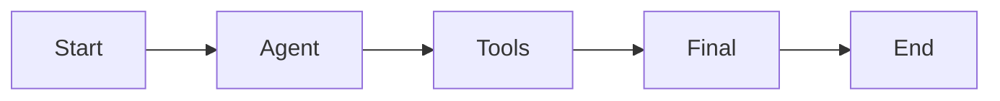
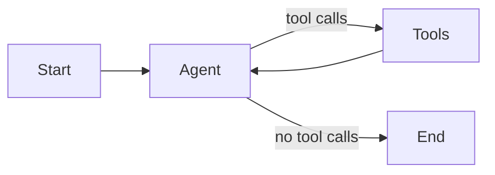

# Tool-Calling Agents

- An agent combines a chat model, tools and an execution loop
- Each model request carries the conversation and the available tool schemas :
  - The model selects a tool and its arguments, such as `bus_info` for CE12-2021-0117
  - Application code executes the requested operation
- Tool results become messages in the conversation
- A model response without tool calls normally ends the loop
- Limits, interrupts and errors can also stop execution

<!-- NOTES:
Timing : Monday afternoon, after State Management. Allow about 60 minutes for the slides and selected demos, then exercise03. Keep the LangChain refresher for participants without ARI510. Skip the refresher when the participant already builds LangChain agents.
Port : ARI510 04 First Agent, Writing the Loop by Hand and Agent Loop.
Source : https://docs.langchain.com/oss/python/langchain/agents
-->

---

# Models and Messages

- A chat model accepts a sequence of messages and returns an `AIMessage`
- Message roles identify the source and purpose :
  - `SystemMessage` supplies instructions
  - `HumanMessage` supplies the request
  - `AIMessage` contains model output and optional `tool_calls`
  - `ToolMessage` contains a result linked by `tool_call_id`
- `llm.bind_tools(tools)` exposes schemas to the model
- Binding tools does not execute them

```python
bound = llm.bind_tools(tools)
message = bound.invoke([("human", "Check the bus parts.")])
print(message.content, message.tool_calls)
```

<!-- NOTES:
Skippable. LangChain refresher. The course setup supplies llm. Source : https://docs.langchain.com/oss/python/langchain/models and /messages
-->

---

# Defining Tools

- `@tool` builds a schema from a function :
  - The name identifies the operation
  - Type hints describe the arguments
  - The docstring describes when to use it
- A tool validates its arguments before it touches the database
- Parameterised SQL keeps a fleet number from being read as SQL

```python
@tool
def bus_info(fleet_no: str) -> str:
    """Look up a Veenhaven bus model and depot by its fleet number."""
    with sqlite3.connect(DB) as conn:
        row = conn.execute(
            "SELECT model, depot_id FROM buses WHERE fleet_no = ?",
            (fleet_no,)).fetchone()
    return json.dumps(dict(zip(["model", "depot_id"], row))) if row else "Unknown bus"
```

<!-- NOTES:
Skippable. Full imports and the second tool are in demo01. Port : ARI510 demo11 tool schemas. Source : https://docs.langchain.com/oss/python/langchain/tools
-->

---

# Agent Single Pass

- The model chooses tools during a single turn
- A final node receives the tool results and writes an answer
- Dependent calls need results from an earlier call :
  - `bus_info` supplies the bus model
  - `parts_for_model` needs that model identifier
- A single pass leaves `parts_for_model` without a real model id ; the model skips it or guesses one
- The saved run reports the parts lookup as missing



<!-- NOTES:
Port : ARI510 08 Agent Single Pass and demo21. The runnable variant routes a response without tool calls directly to final. Show the single pass before the loop, even if the model guesses the correct model identifier.
-->

---

# Agent Loop

- Each tool result gives the model another turn
- The model reads the result before selecting the next operation
- The graph routes by the presence of tool calls :
  - Calls present : execute the tools
  - Calls absent : end the graph
- The saved loop finds CE-DA-03, out of stock, in 3 model calls

```python
loop.add_node("agent", call_model)
loop.add_node("tools", run_tools)
loop.add_edge(START, "agent")
loop.add_conditional_edges("agent", route)
loop.add_edge("tools", "agent")
result = loop.compile().invoke(question, {"recursion_limit": 16})
```

> `demo01 · react-as-a-graph`

<!-- NOTES:
Port : ARI510 08 Agent Loop. demo01 writes dispatch and routing by hand before replacing them. The recursion limit is a graph-step budget, not a model-call counter. Code is in demo01.
-->

---

# ToolNode

- `ToolNode` executes tool calls from the last message :
  - Matches each call to a registered tool
  - Validates the arguments before execution
  - Returns a result with the corresponding call identifier
- Several calls can execute in parallel
- Tools can return `Command` updates for custom state and routing
- An exception raised inside a tool needs its own handling policy

```python
from langgraph.prebuilt import ToolNode

builder.add_node("tools", ToolNode(tools))
```

<!-- NOTES:
Source : https://reference.langchain.com/python/langgraph/prebuilt/tool_node/ToolNode
Distinguish input validation errors from execution exceptions. The default handles invocation errors, not arbitrary execution failures. demo05 covers ToolErrorMiddleware.
-->

---

# tools_condition

- `tools_condition` reads the last message in `state["messages"]` :
  - Tool calls present : returns `"tools"`
  - No tool calls : returns `"__end__"`
- The default route expects a node named `tools`
- A path map can translate the route to another node name

```python
from langgraph.prebuilt import tools_condition

builder.add_conditional_edges("agent", tools_condition)
builder.add_edge("tools", "agent")
graph = builder.compile()
```

> `demo01b · toolnode-and-tools-condition`

<!-- NOTES:
Port : ARI510 08 tools_condition. Source : https://reference.langchain.com/python/langgraph/prebuilt/tool_node/tools_condition
-->

---

# ReAct Agent

- ReAct interleaves reasoning, actions and observations
- Tool-calling agents use the same interaction pattern :
  - The model selects an operation
  - A tool supplies an observation
  - The model uses the observation in its next decision
- The graph shows each action and observation without a printed reasoning transcript
- A custom node can enforce an order, such as the bus lookup before the parts lookup



<!-- NOTES:
Skippable. Port : ARI510 08 ReAct Agent. Source : Yao et al., ReAct, https://arxiv.org/abs/2210.03629. Describe the interaction pattern, not a claim that tool calls reveal private chain of thought.
-->

---

# create_agent

- `create_agent` builds and compiles an agent graph :
  - A model node selects actions or produces an answer
  - A tools node executes requested operations
  - Middleware adds hooks around the loop
- Invocation returns the final state, including the message history

```python
from langchain.agents import create_agent

agent = create_agent(llm, tools=tools,
    system_prompt="Look up the bus first. Use the database for stock. Report unknown records.")
result = agent.invoke(question, {"recursion_limit": 16})
print(result["messages"][-1].content)
print(list(agent.get_graph().nodes))
```

> `demo02 · create-agent`

<!-- NOTES:
Port : ARI510 04 create_agent and demo11. Verified return type on langchain 1.4.5 : CompiledStateGraph. Source : https://reference.langchain.com/python/langchain/agents/factory/create_agent
-->

---

# An Agent as a Node

- A compiled agent can be a node in a parent graph
- Keys the parent and child share, such as `messages`, pass in and out
- The parent controls the surrounding workflow :
  - Deterministic preprocessing before the agent
  - A required handover after its answer
- Different state shapes need a wrapper that maps inputs and outputs

```python
parent = StateGraph(VisitState)
parent.add_node("parts_agent", agent)
parent.add_node("handover", handover)
parent.add_edge(START, "parts_agent")
parent.add_edge("parts_agent", "handover")
parent.add_edge("handover", END)
```

> `demo02b · agent-as-a-node`

<!-- NOTES:
Source : https://docs.langchain.com/oss/python/langgraph/use-subgraphs. Parent VisitState extends MessagesState. demo02 prints the handover. The workshop review message does not authorise a repair.
-->

---

# Custom Agent Logic

- A custom model node controls its prompt and the messages it sends
- Graph edges enforce required steps outside model choice
- A prompt describes the goal and the permitted operations :
  - Look up the bus before selecting compatible parts
  - Report missing records and unavailable stock
  - Refer safety decisions to the workshop
- A prompt guides the model ; only code enforces an action boundary

```python
def call_model(state: MessagesState):
    return {"messages": [bound.invoke([prompt, *state["messages"]])]}
```

<!-- NOTES:
Skippable. Ported prompt guidance from ARI510 04 Defining Agent Goals and Writing Effective Prompts. Code is the custom model node in demo01. Use a deterministic edge for an invariant that must always hold.
-->

---

# Custom Agent State

- `AgentState` contains message history and supports additional fields
- State fields belong to the running conversation :
  - The depot the parts search is limited to
  - A count of model calls, updated by middleware
- Middleware reads and updates those fields
- `ToolRuntime` injects state into tools without exposing a runtime argument to the model

```python
class DepotState(AgentState):
    depot: str
    model_calls: NotRequired[int]

depot_agent = create_agent(llm, tools=[depot_parts],
    state_schema=DepotState, middleware=[depot_prompt, count_calls])
```

> `demo02c · custom-agent-state`

<!-- NOTES:
Port : ARI510 04 Managing Agent State. Source : https://docs.langchain.com/oss/python/langchain/short-term-memory and /runtime. Per-invocation dependencies belong in runtime context. State and context are distinct.
-->

---

# Middleware Hooks

- Agent middleware extends the loop through named hooks

| hook | execution point |
| --- | --- |
| `before_agent` | before the agent loop |
| `before_model` | before each model call |
| `after_model` | after each model call |
| `after_agent` | after the agent loop |
| `wrap_model_call` | around a model request |
| `wrap_tool_call` | around a tool request |

- State hooks can return updates
- Wrappers can call the handler, change the request, or return an alternative result
- Async invocation uses the corresponding async hooks

<!-- NOTES:
Port : ARI510 04 Middleware Hooks. Source : https://docs.langchain.com/oss/python/langchain/middleware/custom. All six names checked on installed AgentMiddleware 1.4.5.
-->

---

# Writing Logging Middleware

- A middleware class can observe every model turn
- A decorated wrapper can observe tool arguments and results
- The saved log shows the bus lookup, then the parts lookup
- A log records tool names and arguments, never keys or personal data

```python
class Logger(AgentMiddleware):
    def before_model(self, state, runtime):
        print("model input messages:", len(state["messages"]))

@wrap_tool_call
def log_tool(request, handler):
    print("tool:", request.tool_call["name"], request.tool_call["args"])
    result = handler(request)
    print("result:", result.content)
    return result
```

> `demo03 · middleware-hooks`

<!-- NOTES:
Port : ARI510 demo12 Watching the Loop and Logging and Monitoring. demo03 adds lifecycle and after_model hooks. Source : https://docs.langchain.com/oss/python/langchain/middleware/custom
-->

---

# Fault Tolerance

- A retry policy repeats selected failed node attempts
- `max_attempts` includes the initial attempt
- `retry_on` selects retryable exceptions
- Node retries precede the node error handler
- The demo node fails twice and succeeds on attempt 3
- A retried part order must not place the order twice

```python
from langgraph.types import RetryPolicy

builder.add_node("inventory", inventory, retry_policy=RetryPolicy(
    max_attempts=3, initial_interval=0.01,
    jitter=False, retry_on=ConnectionError))
```

> `demo04 · node-failures`

<!-- NOTES:
Port : ARI510 08 Fault Tolerance. Source : https://docs.langchain.com/oss/python/langgraph/fault-tolerance. The tiny backoff is a demo setting. Default retry_on excludes several programming errors and most OSError subclasses, including built-in TimeoutError. Built-in ConnectionError is explicitly retryable despite being an OSError subclass. NodeTimeoutError is retryable by default. Verify the selected exception, not its name alone.
-->

---

# Node Run Timeout

- Node `timeout` bounds one async attempt
- A number sets a run timeout in seconds
- `TimeoutPolicy.run_timeout` caps the attempt's wall-clock duration
- Progress does not refresh the run limit
- Expiry raises `NodeTimeoutError` and discards pending writes from the attempt
- Synchronous nodes with a timeout are rejected at graph compilation

```python
await timed(slow_inventory, TimeoutPolicy(run_timeout=0.08))
```

<!-- NOTES:
Source : https://docs.langchain.com/oss/python/langgraph/fault-tolerance. Timeout relies on cooperative asyncio cancellation. Blocking CPU work or time.sleep delays cancellation. asyncio.to_thread does not terminate the underlying thread or undo side effects. Values are demo settings, not latency guidance.
-->

---

# Node Idle Timeout

- `idle_timeout` bounds the time without observable progress
- The refresh policy selects progress signals :
  - `auto` accepts graph and LangChain callback progress
  - `heartbeat` accepts explicit `runtime.heartbeat()` calls
- A heartbeat refreshes the idle limit without changing the run limit
- With both limits set, the first limit reached cancels the attempt

```python
await timed(progressing_inventory,
    TimeoutPolicy(run_timeout=0.08, idle_timeout=0.08,
                  refresh_on="heartbeat"))
```

> `demo04b · node-timeout`

<!-- NOTES:
Source : https://reference.langchain.com/python/langgraph/types/TimeoutPolicy. demo04 shows a run timeout, an idle timeout, successful heartbeats and a run timeout despite heartbeats. It catches the expected errors and demonstrates the compile-time rejection of a sync node.
-->

---

# Node Error Handler

- `error_handler` runs after retries are exhausted or no retry applies
- The handler receives state and a typed `NodeError` parameter :
  - `error.node` identifies the failed node
  - `error.error` contains the exception
- A returned `Command` updates state and routes recovery
- An error raised by the handler fails the run

```python
def on_error(state: LookupState, error: NodeError) -> Command:
    return Command(update={"status": "manual stock check required"},
                   goto="notify")

builder.add_node("inventory", unavailable,
    error_handler=on_error, retry_policy=RetryPolicy(max_attempts=2,
        retry_on=ConnectionError, initial_interval=0.01, jitter=False))
```

> `demo04c · error-handler`

<!-- NOTES:
Port : ARI510 08 Fault Tolerance, corrected. Old sample def on_error(error) omitted state and the typed NodeError injection. Source : https://docs.langchain.com/oss/python/langgraph/fault-tolerance. Do not teach error as a bare exception. demo04 prints the node and exception type after exhausted retries.
-->

---

# Tool Errors

- An unhandled tool execution exception stops the agent
- `ToolErrorMiddleware` selectively converts execution failures into error `ToolMessage` results
- The error callback decides whether to handle the failure :
  - Returned content becomes an error message for the model
  - `None` lets the exception propagate
- Tool argument validation is handled upstream by `ToolNode`

```python
def on_error(exc, request):
    if isinstance(exc, TimeoutError):
        return "Stock service unavailable. Do not infer stock. Ask for a manual stock check."
    return None

safe = create_agent(llm, tools=[live_stock],
                    middleware=[ToolErrorMiddleware(on_error)])
```

> `demo05 · agent-failures`

<!-- NOTES:
Port : ARI510 04 Tool Errors and demo12. Class exists in langchain 1.4.5. Source : https://reference.langchain.com/python/langchain/agents/middleware/tool_error/ToolErrorMiddleware. Middleware does not retry. Errors returned to the model must omit secrets and internal details.
-->

---

# Model Fallback

- `ModelFallbackMiddleware` tries fallback models when a model call raises
- The primary model is supplied to `create_agent`
- Fallbacks are supplied to the middleware in order
- If every attempt fails, the last exception propagates
- A fallback model needs tool calling and the agent's request settings

```python
agent = create_agent(primary, tools=tools,
    middleware=[ModelFallbackMiddleware(llm)],
    system_prompt="Use the database for stock. Look up the bus before its parts.")
out = agent.invoke(question, {"recursion_limit": 16})
```

> `demo05b · model-fallback`

<!-- NOTES:
Port : ARI510 04 Retries and Fallbacks. Source : https://reference.langchain.com/python/langchain/agents/middleware/model_fallback/ModelFallbackMiddleware. demo05 injects a failing fake primary and falls back to the course model, so no invalid-model API request is needed. A fallback handles exceptions, not incorrect answers.
-->

---

# Model Call Limit

- `ModelCallLimitMiddleware` bounds model calls :
  - `run_limit` applies to the current invocation
  - `thread_limit` accumulates in persisted state
- `exit_behavior="end"` ends with a limit message
- `exit_behavior="error"` raises an exception
- Graph recursion limits count graph steps, including middleware nodes

```python
middleware = ModelCallLimitMiddleware(run_limit=1, exit_behavior="end")
agent = create_agent(repeated_stock(), tools=[bus_info],
                     middleware=[middleware])
```

<!-- NOTES:
Port : ARI510 04 Bounding the Loop. Source : https://docs.langchain.com/oss/python/langchain/middleware/built-in. A low limit deliberately prevents completion in demo05. Production settings need measurements of successful and failed tasks.
-->

---

# Tool Call Limit

- `ToolCallLimitMiddleware` counts tool calls per run or thread
- `tool_name` restricts the counter to one tool
- Exit behaviour controls what happens at the limit :
  - `continue` returns an error for blocked calls and keeps the agent running
  - `end` stops the agent
  - `error` raises an exception
- With `continue`, an agent can keep requesting the blocked tool ; a model-call limit stops it

```python
middleware = ToolCallLimitMiddleware(tool_name="bus_info",
                                     run_limit=1, exit_behavior="end")
```

> `demo05c · call-limits`

<!-- NOTES:
Port : ARI510 04 Bounding the Loop. Source : https://docs.langchain.com/oss/python/langchain/middleware/built-in. The default exit behaviour is continue, while the model limit defaults to end. demo05 scripts repeated calls to make the limit path reproducible.
-->

---

# LangSmith Tracing

- Tracing records the run tree with model and tool calls :
  - Inputs, outputs and errors
  - Timing and provider-reported token usage
- `tracing_context` can enable tracing for a scoped block
- The client uses the configured LangSmith region endpoint
- Project names group related traces
- A tracing failure is printed and the answer still returns

```python
with tracing_context(enabled=True, client=client, project_name=PROJECT):
    out = agent.invoke(question)
client.flush()
```

> `demo06 · tracing-with-langsmith`

<!-- NOTES:
Trainer demo. Port : ARI510 demo09 and 04 Logging and Monitoring. Source : https://docs.langchain.com/langsmith/trace-without-env-vars. The notebook reads the EU endpoint, prints the project, confirms its root run with client.runs.retrieve, and leaves LANGSMITH_TRACING=false unchanged. Use the named project in the EU UI. Do not show credentials.
-->

---

# Testing Strategies

- Unit tests check tools and middleware without a model API
- Scripted agent tests check graph execution and tool-result handling
- Real-model evaluations check choices and answer quality on labelled cases
- Production monitoring detects failures outside the evaluation set
- Each layer answers a different question :
  - A scripted tool call proves the wiring executes that call
  - An evaluation checks whether the real model chooses a suitable call
- Incidents supply new regression and evaluation cases

<!-- NOTES:
Port : ARI510 11 Testing Strategies. Evaluations and production monitoring return in module09. Source : https://docs.langchain.com/oss/python/langchain/test/unit-testing
-->

---

# Unit Tests with a Fake Model

- `GenericFakeChatModel` returns scripted messages
- Agents with tools need a `bind_tools` override on the fake
- Scripted tool calls exercise the real tool and agent wiring
- A scripted final answer does not prove the model interpreted the result

```python
class FakeToolModel(GenericFakeChatModel):
    def bind_tools(self, tools, **kwargs):
        return self

fake = FakeToolModel(messages=iter([
    call("CE-DA-03"), AIMessage("CE-DA-03 is out of stock.")]))
```

> `demo07 · testing-agents`

<!-- NOTES:
Port : ARI510 11 Unit Tests with a Fake Model and demo32. demo07 prints the plain fake's NotImplementedError, then runs the subclass. No setup cell, environment key or provider call. Source : https://reference.langchain.com/python/langchain-core/language_models/fake_chat_models/GenericFakeChatModel
-->

---

# Testing Memory

- `InMemorySaver` persists graph state within a process
- A thread identifier selects the conversation
- Tests check memory independently of scripted answer text :
  - Earlier tool results remain in the saved message history
  - A different thread starts without that history
- A new agent and saver per test isolate cases
- Persistent production storage needs additional integration tests

```python
config = {"configurable": {"thread_id": "first"}}
saved = agent.get_state(config).values["messages"]
assert any(m.type == "tool" and m.content == "0" for m in saved)
```

<!-- NOTES:
Port : ARI510 demo32, extended with InMemorySaver as requested in the plan. Source : https://docs.langchain.com/oss/python/langchain/test/unit-testing and https://docs.langchain.com/oss/python/langgraph/persistence
-->

---

# Running pytest

- A test file can run independently of the notebook
- Assertions should check observable behaviour :
  - Tool result content and call identifier
  - Explicit unknown-record handling
  - Saved history and thread isolation
- `check_returncode` fails the cell when a test fails

```python
run = subprocess.run([sys.executable, "-B", "-m", "pytest", "-p",
                      "no:cacheprovider", "-q", str(test_path)],
                     capture_output=True, text=True)
print(run.stdout)
run.check_returncode()
```

> `demo07b · pytest`

<!-- NOTES:
Port : ARI510 demo32 pytest section. The generated test_module04_agent.py stays beside the notebook and is ignored by notebooks/**/test_*.py. Run All generates it and verifies the return code. Source : https://docs.pytest.org/en/stable/how-to/usage.html
-->

---

# Best Practices

- A single agent with a narrow tool list comes first
- Required steps sit in graph edges, outside the model's choice
- Tools return `Unknown part` or a recorded zero, so the model has no gap to fill
- Limits bound model calls, tool calls and external-service time
- Retries suit transient failures of idempotent operations
- Traces record the tool path ; measurements record calls and tokens
- Scripted models test the wiring ; real-model evaluations test quality
- Repair and safety decisions go to the workshop ; a stock lookup does not clear a bus for service

<!-- NOTES:
No new numerical claims. Tie the points to the Veenhaven examples. The course thesis is one agent first, measurement before adding agents. A stock lookup does not certify a bus safe for service.
-->

---

# Summary : Building Agents

- A tool-calling agent is a model and tools connected by a loop
- `ToolNode` and `tools_condition` provide dispatch and routing
- `create_agent` compiles the loop into a graph that can be a node
- Custom state and middleware extend agent behaviour
- Retry policies, timeouts and error handlers control node failures
- Agent middleware handles tool errors, model fallback and call limits
- Traces expose execution, while scripted tests verify wiring and memory
- Real-model evaluations are required to assess model choices and answer quality

> `exercise03 · An Agent with Tests`

<!-- NOTES:
Close before exercise03. The exercise guide and starter are owned by the lead, not this module implementation.
-->
