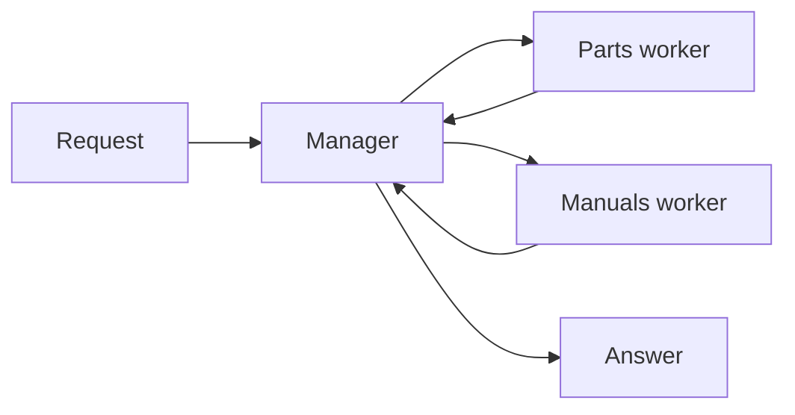
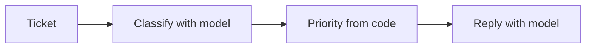

# Multi-Agent Concepts

- A multi-agent system splits work across agents with separate context
- Multi-agent design is context engineering :
  - Decide which facts, instructions and tools each agent sees
  - Decide which findings return to the caller
- Measurable problems justify another agent :
  - Tool overload causes incorrect tool selection
  - Specialised prompts compete inside one context
  - Intermediate work crowds the context used for the answer
- One agent comes first, measured on quality, calls, tokens and seconds
- Each pattern is built from LangGraph nodes before a harness hides it

<!-- NOTES:
Timing : Tuesday morning. Allow about 90 minutes for the core slides and committed notebook outputs, then exercise04 and capstone stage 2. Full live execution includes deliberate rate limiting and is not the classroom timing. Cut hierarchical teams, the documentation comparison and orchestration shapes first when time is short.
Port : ARI510 10 Multi-Agent Concepts. Source : https://docs.langchain.com/oss/python/langchain/multi-agent/index ; checked 14 October 2026. The one-agent baseline returns in demo09. The brief's OpenRouter Luna model supersedes the older Qwen instruction in AGENTS.md.
-->

---

# Agent Roles and Responsibilities

- Each agent gets one responsibility, stated in its prompt :
  - A parts specialist answers stock questions from the database
  - A manuals specialist returns error guidance with a source
  - A coordinator delegates and writes the final answer
- Each agent gets the tools needed for its role
- A description tells the coordinator when to use each specialist
- A delegated task includes relevant identifiers and completion criteria
- A missing fact is traced in the worker's answer first, then in the synthesis
- A different model per role needs an evaluation that shows the gain

<!-- NOTES:
Port : ARI510 10 Agent Roles and Responsibilities. Every executed example uses the course model, openai/gpt-6-luna. Model-per-role selection is a production topic in module 09, not a measured claim here.
-->

---

# Choosing a Pattern

- The LangChain documentation names these patterns :

| Pattern | Control | Suitable task |
| --- | --- | --- |
| Subagents | Main agent calls workers as tools | Isolated specialist work |
| Handoffs | Tool updates the active stage | Multi-stage conversation |
| Skills | Agent loads instructions | Specialities in one context |
| Router | Classifier dispatches and combines | Distinct input categories |
| Custom workflow | Graph fixes the execution flow | Business process with rules |

- Patterns nest ; a workflow node can be a router or a subagent
- A parts subagent and a parts skill route the same way ; only the subagent gets its own context

<!-- NOTES:
Port : ARI510 10 Choosing a Pattern. Source : https://docs.langchain.com/oss/python/langchain/multi-agent/index. Handoffs may switch subgraphs or one agent's configuration. Skills are a pattern within one agent.
-->

---

# Pattern Capabilities

- LangChain's documentation rates the patterns by capability :

| Pattern | Separate teams | Parallel | Multi-hop | User interaction |
| --- | --- | --- | --- | --- |
| Subagents | High | High | High | Low |
| Handoffs | Unrated | Unrated | High | High |
| Skills | High | Medium | High | High |
| Router | Medium | High | Unrated | Medium |

- The ratings are LangChain's, for the documented architectures
- Custom workflows combine capabilities through explicit graph structure
- A rating says nothing about answer quality or cost on the bus question

<!-- NOTES:
Skippable. Source : https://docs.langchain.com/oss/python/langchain/multi-agent/index#choosing-a-pattern, checked 14 October 2026. High/medium/low paraphrase the docs' five/three/one-star ratings ; Unrated means the docs show a dash, not that the API forbids the capability. Separate teams denotes distributed development. This is their matrix, not our benchmark. Recorded in build/measurements-05.md.
-->

---

# Documentation Call Counts

- LangChain illustrates these calls and processed tokens :

| Pattern | One request | Repeat turn | Three domains |
| --- | --- | --- | --- |
| Subagents | 4 calls | 4 calls | 5 calls, about 9K tokens |
| Handoffs | 3 calls | 2 calls | 7+ calls, about 14K+ tokens |
| Skills | 3 calls | 2 calls | 3 calls, about 15K tokens |
| Router | 3 calls | 3 calls | 5 calls, about 9K tokens |

- The repeat turn reuses the active agent or loaded skill
- Loaded instructions remain in subsequent calls to the same agent
- The counts come from LangChain's own examples ; the bus measurements are in demo09

<!-- NOTES:
Skippable. Port : the Choosing a Pattern comparison, extended with the docs' call tables. Source : https://docs.langchain.com/oss/python/langchain/multi-agent/index#performance-comparison. One-shot and repeat examples use a purchase task ; multi-domain uses language comparisons with about 2000 tokens of documentation per domain. Do not describe these counts as measured on Luna or the Veenhaven data. Recorded in measurements-05.md.
-->

---

# Subagents

- A subagent is an agent wrapped as a tool
- Each worker's model and tool loop is a LangGraph graph

```python
workers = specialists(llm)

@tool
def call_parts(question: str) -> str:
    """Ask the parts specialist about stock and location."""
    result = workers["parts"].invoke(ask(question), LIMIT)
    return last_text(result)

coordinator = agent_by_hand(llm, [call_parts, call_manuals],
    "Delegate both data questions, then answer briefly.")
```

- The coordinator sees the worker's final answer as a tool result, never its tool calls

> `demo01 · subagents`

<!-- NOTES:
Port : ARI510 10 Subagents and demo28 ; agent_by_hand replaces create_agent so the loop remains visible. Code abbreviates the notebook's instrumentation. Source : https://docs.langchain.com/oss/python/langchain/multi-agent/subagents ; installed ToolNode and tools_condition. Helpers are defined in demo01.
-->

---

# Subagent Context

- The worker starts with the delegated question and its own prompt
- Each worker retains its own model and tool exchanges
- The coordinator retains the task and returned answer
- Every fact crosses the boundary in the task or in the answer :
  - A task without fleet number CE12-2021-0117 can change the parts lookup
  - An answer without the 80 percent airflow condition changes the final advice
- A fresh worker invocation does not inherit earlier worker history

> `demo01b · subagent-context`

<!-- NOTES:
Port : ARI510 10 Subagent Context. Inspect the histories from the same run, without making another call. Source : https://docs.langchain.com/oss/python/langchain/multi-agent/subagents. The notebook keeps traces in inner for inspection, not as input to subsequent workers. Message passing belongs to module 06 ; fork-mode harness context belongs to module 08.
-->

---

# Manager-Worker

- A manager owns task decomposition and the final answer
- Workers own bounded tasks and return findings
- Manager-worker can use agents as tools or explicit graph nodes
- Code controls the available workers and the stopping budget
- The manager decides whether a returned finding needs more work
- A lookup with known inputs, such as stock for CE-CF-02, stays an ordinary function



<!-- NOTES:
New. Outline vocabulary maps to the subagents pattern in build/research-2026-10.md. The next two slides implement explicit-node dispatch and a nested team. This diagram describes control ownership, not a requirement to call every worker.
-->

---

# A Supervisor Node

- A supervisor node selects an unfinished worker and a task
- The selected worker receives that task in a separate context
- Each completed worker returns to the supervisor
- Findings are keyed by worker ; code caps the loop at two worker rounds

```python
graph.add_edge(START, "supervisor")
for name in workers:
    graph.add_node(name, worker(name))
    graph.add_edge(name, "supervisor")
graph.add_conditional_edges("supervisor", lambda s: s["next"],
                            ["parts", "manuals", "finish"])
graph.add_edge("finish", END)
```

- A supervisor that finishes early or dispatches parts twice can leave out the manual's condition

> `demo02 · supervisors`

<!-- NOTES:
New. demo02 a uses Decision with next and task, with_structured_output, StateGraph nodes and conditional edges. The notebook prints each decision and checks the final facts. The bound is a resource limit, not proof that both tasks were covered. Installed APIs inspected on 14 October 2026.
-->

---

# Hierarchical Teams

- Hierarchical orchestration nests one team inside another
- The outer manager receives the maintenance team's report
- The outer synthesis adds a context boundary and a model call ; 8 calls against 7 for the team alone
- A fact can drop out at either report

```python
def manage(state):
    report = team.invoke(team_input(state["question"]), LIMIT)
    return {"report": report["answer"]}

manager.add_node("maintenance_team", manage)
manager.add_edge("maintenance_team", "manager")
```

> `demo02b · hierarchical-teams`

<!-- NOTES:
Skippable. New. demo02 b wraps the compiled supervisor graph in maintenance_team and adds an outer compose call. This is an output-only manager after the team, not a second model that dynamically dispatches teams. A production hierarchy might select among several team graphs ; this example exposes the nested context boundary with one team.
-->

---

# Router

- A classifier selects specialists and writes their subquestions
- Dispatch executes the selected tasks
- A final node combines the specialist answers
- Classification occurs once per request in this graph
- A stock-only question selects only the parts worker
- A question about stock and fault F-CE-110 selects both workers
- Follow-up memory requires a surrounding conversation or checkpointer

> `demo03 · router`

<!-- NOTES:
Port : ARI510 10 Router, first shown with sequential dispatch so classification is the visible idea. Source : https://docs.langchain.com/oss/python/langchain/multi-agent/router. The example does not persist conversation state across invocations.
-->

---

# Router Code

- `Send` supplies each selected branch with its own input

```python
def dispatch(state):
    return [Send(r["agent"], {"question": r["query"]})
            for r in state["routes"]]

class RouterState(TypedDict):
    question: str
    routes: list[dict]
    answers: Annotated[list[str], operator.add]
    final: str

graph.add_conditional_edges("classify", dispatch,
                            ["parts", "manuals"])
```

- Each branch returns a new answer entry through the reducer
- Synthesis runs after the selected branches finish

> `demo03b · router-parallel`

<!-- NOTES:
Port : ARI510 10 Router Code. Source : installed Send and StateGraph on 1.2.15 ; demo03 b. Both worker nodes have an edge to synthesise and execute in the same superstep, so synthesis follows the combined updates. Fixed joins appear in demo06. Shared rate limiting can eliminate a latency advantage even when the graph dispatches concurrently.
-->

---

# Delegation and Handoff

| Property | Delegation | Handoff |
| --- | --- | --- |
| Caller | Waits for the task result | Transfers the active role |
| Worker output | Returns to the coordinator | Continues the conversation |
| Typical context | Bounded task | Conversation with retained facts |
| Control | Coordinator chooses the next action | Active agent or step chooses it |

- A parts lookup suits delegation
- Triage that collects a bus number can hand off to a specialist
- Either choice still has to settle how much history the receiver gets

<!-- NOTES:
Port : ARI510 10 Delegation and Handoff. Replaces the source's two tall sequence diagrams with a comparison table. Sources : LangChain subagents and handoffs pages. Detailed message contracts and communication protocols are module 06.
-->

---

# Handoffs

- A tool changes the active agent through `Command.PARENT`
- The documented subgraph example forwards the last assistant message
- The probe exposes two faults in that transfer :
  - A stock result from the same turn is dropped ; the provider rejects the unanswered tool call
  - An earlier lookup is lost ; the receiver gives guidance and reports stock unavailable
- Seeded histories reproduce both faults against the live model

> `demo04 · handoffs`

<!-- NOTES:
Port : ARI510 10 Handoffs, extended with the measured faults. Source : https://docs.langchain.com/oss/python/langchain/multi-agent/handoffs#multiple-agent-subgraphs ; build/measurements.md and build/probe_patterns.py. The documented forwarding is still present when checked 14 October 2026. demo04 a uses seeded AI tool calls to make each history fault reproducible ; the receiver calls the live provider. Only the expected malformed-history rejection is caught. An accepted malformed history is printed, not hidden.
-->

---

# Fixed Handoffs

- An agent that can transfer control makes one tool call at a time
- The transfer forwards the worker's full history and a matching receipt

```python
return Command(
    goto=target, graph=Command.PARENT,
    update={"active_agent": target, "messages": [
        *runtime.state["messages"],
        ToolMessage(content="Transferred to " + target,
                    tool_call_id=runtime.tool_call_id)
    ]})
```

- With the lookups retained, the receiver answers stock, location and condition
- An agent can still stop before it transfers ; the earlier probe recorded one half answer in three

> `demo04b · handoffs-fixed`

<!-- NOTES:
New. Fixes from build/probe_patterns.py. demo04 b builds both worker loops from StateGraph and ToolNode, using a model copy with model_kwargs.parallel_tool_calls=False. Full-history transfer is a local fix for this demo ; large histories still need deliberate context design. Handoff reliability is measured in demo09, not inferred from the protocol fix.
-->

---

# Handoff Middleware

- One agent keeps the conversation and the active step in state
- `record_bus` validates the fleet number and updates the step
- Middleware chooses the prompt and tools for each model call

```python
@wrap_model_call
def apply_step(request, handler):
    if request.state.get("current_step", "triage") == "triage":
        return handler(request.override(
            system_prompt="Collect the fleet number.",
            tools=[record_bus]))
    return handler(request.override(
        system_prompt="Answer using the tools.",
        tools=[part_stock, fault_guidance]))
```

- A checkpointer retains the step across user turns

> `demo04c · handoffs-one-agent`

<!-- NOTES:
Port : ARI510 10 Handoff Middleware and demo28, after showing hand-built graph transfers. Source : installed wrap_model_call, ModelRequest.override and create_agent ; https://docs.langchain.com/oss/python/langchain/multi-agent/handoffs#single-agent-with-middleware. Prompts are shortened on the slide ; the notebook includes the recorded bus and a restriction against triage advice.
-->

---

# Skills

- A skill contains instructions loaded into the current agent's history
- Names and descriptions identify the available specialities

```python
@tool
def load_skill(name: str) -> str:
    """Load task instructions. Names: parts or manuals."""
    return SKILLS.get(name, "Unknown skill.")

skilled = agent_by_hand(llm,
    [load_skill, part_stock, fault_guidance],
    "Load each matching skill before using its tools.")
```

- The same agent keeps control and retains the loaded instructions
- The prompt asks for the skill first ; nothing stops a tool call without it

> `demo05 · skills`

<!-- NOTES:
Port : ARI510 10 Skills and demo28. Source : https://docs.langchain.com/oss/python/langchain/multi-agent/skills. The hand-built tool loop shows progressive disclosure. Tool scoping and skill files in Deep Agents belong to module 08 ; this skill loader returns plain instructions and does not hide tools.
-->

---

# Specialized Agents

- Specialisation can use a subagent or a skill
- A subagent isolates intermediate work :
  - The worker keeps its own tool exchanges
  - The caller receives a bounded result
- A skill retains intermediate work in the conversation :
  - Follow-ups can reuse the loaded instructions and findings
  - Later calls process the accumulated context
- The isolated stock worker reads 226 input tokens ; the skills agent 1,139 for the full question
- The single agent answers the full question with 435 input tokens

> `demo05b · subagent-or-skill`

<!-- NOTES:
New. Published outline term uses specialized agents ; the prose otherwise uses house-style British spelling. Sources : subagents and skills docs, build/academy-deepagents-notes.md for ideas only. demo05 b inspects skill tool messages and runs an isolated worker. No Academy text or code copied.
-->

---

# Custom Workflow

- A LangGraph workflow combines agent steps with ordinary code
- The developer fixes dependencies and the order of execution
- Agent steps handle classification or writing
- Code applies known business rules and database lookups
- A workflow can contain subagents, routers or handoffs as nodes
- Each node exposes a state input and an update for inspection



<!-- NOTES:
Port : ARI510 10 Custom Workflow. The source's raster sequence diagram is replaced with a code-native flow. Source : https://docs.langchain.com/oss/python/langchain/multi-agent/custom-workflow. The fixed ticket pipeline remains the original demo shape, on a Veenhaven ticket.
-->

---

# Sequential Pattern

- A ticket follows classification, priority assignment and response
- Structured output restricts classification to the permitted labels
- Priority comes from a lookup table

```python
def prioritise(state):
    return {"priority": {
        "complaint": "high", "question": "normal", "praise": "low"
    }[state["category"]]}

graph.add_edge(START, "categorise")
graph.add_edge("categorise", "prioritise")
graph.add_edge("prioritise", "respond")
graph.add_edge("respond", END)
```

- The prompt forbids a repair date ; the saved reply gives none

> `demo06 · workflows`

<!-- NOTES:
Port : ARI510 10 Sequential Pattern and demo28. demo06 a reads tickets.csv and runs the three nodes ; only classification and response invoke a model. The known priority rule stays deterministic. Structured output replaces the original string extraction.
-->

---

# Parallel Agents

- Independent parts and manuals tasks can run concurrently
- Separate state keys retain their distinct results

```python
graph.add_edge(START, "parts")
graph.add_edge(START, "manuals")
graph.add_edge(["parts", "manuals"], "compose")
graph.add_edge("compose", END)
```

- The join edge waits for both branches before composition
- Dynamic map-reduce uses `Send` and a reducer for collected results
- Tokens add up across the branches ; running them in parallel saves none
- The shared limiter cancels the speed-up : 42.4 seconds parallel, 41.8 sequential

> `demo06b · workflows-parallel`

<!-- NOTES:
Port : ARI510 10 Parallel Agents. demo06 b compares fixed sequential and parallel graphs on identical tasks ; demo03 b shows Send-based routing and demo08 b shows repeated Send to the same node. Fixed task inputs are specific to this bus question, not a general parser for any new question.
-->

---

# Orchestration in Code

- With CE-CF-02 and F-CE-110 known, no model has to choose a tool
- Code fetches the stock and error guidance
- A model composes the answer in one call, against five for the sequential agents

```python
def fetch(state):
    return {
        "stock": part_stock.invoke({"part": "CE-CF-02"}),
        "guidance": fault_guidance.invoke({"error_code": "F-CE-110"})
    }

graph.add_edge(START, "fetch")
graph.add_edge("fetch", "compose")
graph.add_edge("compose", END)
```

- Code guarantees the scheduled lookups ; composition still needs checking

> `demo06c · orchestration-in-code`

<!-- NOTES:
New. Academy delegation ideas adapted in our own words. The loop or graph in code establishes coverage without asking the model to remember each required item. demo06 c and demo09 expose the reduced model-call count. This variant deliberately hard-codes the two known lookup arguments ; it does not claim to parse arbitrary natural-language requests.
-->

---

# Collaborative Agents

- Collaborative agents work on one parts note or one repair decision
- Maker-checker separates writing the note from reviewing it
- Debate gives a judge two proposals, such as inspecting the fan or replacing it
- Generate and filter keeps only the notes that pass the database checks
- Every shape needs the same evidence, such as stock records and the manual
- Code sets the completion rule and the attempt cap
- Two models that agree can both be wrong ; the database settles a stock count

<!-- NOTES:
New. Ideas from build/academy-deepagents-notes.md, delegation section. Original course examples and code ; no Academy content copied. Module 06 covers message passing, conflict resolution and A2A. This module covers the orchestration shapes and their local answer checks.
-->

---

# Maker-Checker

- A maker writes a parts note from database evidence
- A model checker returns approval and specific feedback
- A rejected draft returns to the maker with the feedback

```python
graph.add_edge(START, "make")
graph.add_edge("make", "check")
graph.add_conditional_edges("check", lambda s:
    END if s["approved"] or s["rounds"] >= 2 else "make",
    ["make", END])
```

- Both roles need the required counts, locations and zero-stock warning
- Reaching the attempt cap can leave the draft unapproved
- The saved model checker approves a note the code checker rejects for a missing zero

> `demo07 · maker-checker`

<!-- NOTES:
Port : ARI510 10 Maker-Checker, upgraded from wording-only criteria to database facts. The module map puts the model checker before the code checker, reversing those two source slides. demo07 a prints the model verdict and independent code findings. The two-attempt bound is an executable configuration recorded in measurements-05.md, not an observed claim about model convergence.
-->

---

# Checkers Written in Code

- Queryable facts support deterministic checks :
  - Required part numbers, stock counts and locations
  - An explicit warning for zero stock
- A check returns specific repair findings
- The maker receives those findings on the next attempt
- The demo starts from a draft that marks CE-DA-03 available ; its stock is 0
- Formatting requirements can reject a factually correct paraphrase
- A pass proves only what `check_note` tests, such as identifiers, digits and locations
- Remaining findings stay visible when the attempt cap is reached

> `demo07b · checker-in-code`

<!-- NOTES:
Port : ARI510 10 Checkers Written in Code. demo07 b starts with CE-DA-03 marked available despite zero stock, prints check_note findings and invokes the bounded maker. The checker recognises digits and same-line facts ; it is deliberately narrow. A broader truth or safety claim does not follow from passing.
-->

---

# Debate with a Judge

- Two agents argue different first actions, inspecting the fan or replacing it
- Both agents receive the same manual excerpt and stock evidence
- A judge sees the proposals and the source evidence
- The judge returns its selected action and reason
- Six fans in stock do not justify a replacement
- The manual replaces the fan only below 80 percent airflow
- The saved judge selects inspection and keeps the airflow condition

> `demo08 · debate-and-selection`

<!-- NOTES:
New. demo08 a uses parallel proposals followed by a fixed join and a structured Judgement. It is a one-round debate with a judge, not an open-ended exchange between peers. The manual says to check airflow first and replace the fan only below the stated threshold. Academy adversarial-verification idea only ; wording and implementation are ours.
-->

---

# Generate and Filter

- Independent calls write the parts note in different styles, bullets or a table
- Code checks each candidate against the database facts
- Invalid candidates retain their rejection findings
- Selection chooses the shortest passing candidate
- A stable role label breaks equal-length ties
- An empty set of passing candidates returns an explicit failure
- More candidates increase calls and tokens without guaranteeing a pass

```python
return [Send("generate", {"task": style}) for style in
        ["Compact bullets.", "A compact table."]]
```

> `demo08b · generate-and-filter`

<!-- NOTES:
New. demo08 b generates separate style variants and applies check_note to each. The shortest passing note is a presentation policy, not a claim that it is the best answer. Source for shape names only : build/academy-deepagents-notes.md and https://github.com/langchain-ai/lca-deepagents. No text, diagram or code copied.
-->

---

# Orchestration Shapes

- Named shapes describe execution and selection policies :

| Shape | Bus maintenance application |
| --- | --- |
| Classify and act | Select the specialist for a ticket |
| Fan-out and synthesise | Combine stock and manual findings |
| Adversarial verification | Challenge a proposed replacement |
| Generate and filter | Keep notes that pass factual checks |
| Tournament | Compare surviving proposals in rounds |
| Loop until done | Repair until checks pass or the budget ends |

- Code defines coverage, joins and bounded termination
- Deep Agents packages delegation and context management in module 08

<!-- NOTES:
Skippable. New. Names from the Academy delegation notes ; explanations and examples are ours. Tournament is a named extension, not an executed notebook in the course map. Loop until done always needs a cap or another explicit failure outcome. Dynamic subagents and recursive splitting remain in module 08.
-->

---

# Evaluating the Boundaries

- Each boundary gets its own check :
  - The specialist's answer against the stock records
  - The delegated task for the fleet number and the condition asked for
  - The returned findings for facts lost on the way back
  - The final answer against the whole request
- The comparison includes one agent with both tools
- A keyword check passes a sentence that contradicts itself
- Failures are read before a prompt changes or an agent is added

<!-- NOTES:
Port : ARI510 10 Evaluation Strategies, scoped to this module's measurements. demo09 prints every answer and the coarse completeness checks. Production tracing, labelled eval sets and trajectory evaluation belong to module 09. No claim that the quick checks certify factual correctness.
-->

---

# Supervisor and Swarm Packages

- Earlier prebuilt packages supplied multi-agent graphs :
  - `langgraph-supervisor` centralised worker coordination
  - `langgraph-swarm` switched between active agents
- Existing tutorials and applications still contain these packages
- The documented patterns expose the same control choices :
  - A supervisor uses agents as tools or worker nodes
  - A swarm-style transfer uses handoffs and an active-agent key
- Both shapes need only nodes, conditional edges and `Command`

<!-- NOTES:
Skippable. Port : ARI510 10 Supervisor and Swarm Packages. History only ; neither package is installed or required by this module. build/research-2026-10.md records the release history checked on 13 October. Avoid equating lack of releases with proof that existing installations cannot work. Deep Agents is a forward pointer to module 08.
-->

---

# The Earlier Pattern Probe

- Luna medians on a stock-and-workshop question, 13 October 2026 :

| Pattern | Correct | Calls | Input | Output | Seconds |
| --- | --- | --- | --- | --- | --- |
| Single agent | 3/3 | 2 | 399 | 96 | 6.7 |
| Subagents | 3/3 | 6 | 781 | 204 | 20.3 |
| Handoffs, fixes applied | 2/3 | 4 | 1,165 | 99 | 13.5 |
| Skills | 3/3 | 4 | 1,036 | 131 | 14.6 |
| Router | 3/3 | 6 | 622 | 184 | 20.6 |
| Custom workflow | 3/3 | 5 | 472 | 129 | 17.0 |
| Deep Agent, module 08 | 3/3 | 6 | 11,044 | 214 | 20.6 |

- Seconds include rate limiting at 0.3 requests per second
- The fixture is small and in memory, with stock for BR-220 and one workshop slot

<!-- NOTES:
New. Source : build/measurements.md and build/probe-patterns-gpt-6-luna.json, three runs each, openai/gpt-6-luna via OpenRouter, reasoning none, temperature 0, pinned stack. Router scored 3/3 after accepting the word six ; the raw JSON still marks that row false. Handoff fixes are already present in the probe, but one agent still stopped with half an answer. The Deep Agent row is a forward pointer to the module 08 comparison ; no harness implementation is taught here.
-->

---

# What Each Pattern Costs

- Luna medians on the Veenhaven records, 14 October 2026 :

| Pattern | Correct | Calls | Input | Output | Seconds |
| --- | --- | --- | --- | --- | --- |
| Single agent | 3/3 | 2 | 435 | 113 | 17.9 |
| Subagents | 3/3 | 6 | 954 | 263 | 50.4 |
| Handoffs, fixes applied | 3/3 | 4 | 1,215 | 108 | 33.9 |
| Skills | 3/3 | 4 | 1,139 | 162 | 33.8 |
| Router | 3/3 | 6 | 816 | 247 | 50.0 |
| Custom workflow | 3/3 | 5 | 632 | 192 | 42.2 |
| Code lookups | 3/3 | 1 | 129 | 57 | 9.4 |

- Seconds include the shared limiter at 0.12 requests per second
- Code lookups use the known part and error-code arguments
- The single agent needs fewer calls and tokens than every multi-agent pattern

> `demo09 · what-each-pattern-costs`

<!-- NOTES:
New. demo09 runs the single agent, subagents, fixed handoffs, skills, router, custom workflow and code-lookups variant three times each. Raw rows live beside the executed notebook in demo09-results.json ; the measured table is recorded in build/measurements-05.md. Each column is a separate median. All 21 answers were read and preserve the stock, location and airflow condition ; the keyword checks also pass. This uses real demo records, still fictional data, unlike the probe's small in-memory fixture. Seconds cannot be labelled model latency. These results do not prove that the fixed handoff always transfers ; the earlier probe and demo02 retain their failures.
-->

---

# Summary : Multi-Agent Patterns

- Multi-agent design controls what each agent sees and returns
- One agent is the baseline for a measured architecture decision
- Subagents isolate work ; skills retain it in one conversation
- Supervisor and manager-worker graphs coordinate bounded tasks
- Hierarchical teams introduce another context and output boundary
- Routers classify and dispatch ; handoffs change the active role
- Workflows fix sequential dependencies and parallel joins
- Collaborative patterns need evidence, checks and bounded completion
- Code handles known orchestration rules and deterministic checks
- Calls, tokens, seconds and answer quality determine the trade-off

<!-- NOTES:
Close with exercise04 A Multi-Agent Visit Planner and capstone stage 2, owned by the lead. Forward pointers only : module 06 for message passing, conflict resolution and A2A ; module 08 for Deep Agents. Ask the participant which measured limitation of their single agent would justify adding a specialist.
-->
