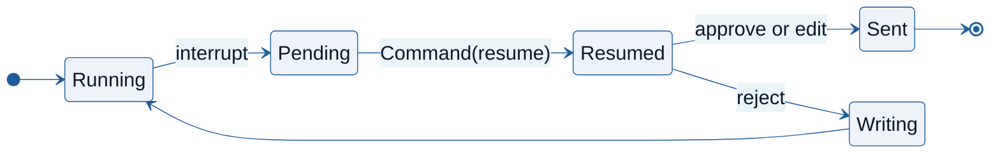

# Advanced Workflows

- A workflow can pause for a human decision :
  - Before a part reservation or a log overwrite at the Veenhaven depot
  - Inside a subgraph or a subagent tool
- A workflow can bound its own loops :
  - A watchdog node stops a diagnosis that makes no progress
  - A guard blocks a repeated tool call
- A workflow can recover from failure :
  - Retries with backoff around a remote stock lookup
  - A fallback chain from live data to a snapshot to a manual queue
  - Resume from a checkpoint after a crash or a drain
- Subgraphs compose workflows owned by different teams

<!-- NOTES:
Timing : Tuesday afternoon, after Agent Communication. Allow about 60 minutes for the slides and demos.
Source : ARI520 course plan, module 07. The Deep Agents material moved to module 08. Demos and versions recorded in build/measurements-07.md : LangGraph 1.2.15, LangChain 1.4.5.
-->

---

# Human-in-the-Loop

- An agent loop can act on a wrong conclusion :
  - Order traction cooling fans that bus BW-7001 does not need
  - Overwrite a verified maintenance log without depot sign-off
- A human-in-the-loop workflow pauses before such an action :
  - A reviewer sees the proposed action or the draft
  - The paused state sits in the checkpointer, with no time limit
- The graph continues only when the reviewer supplies a decision

<!-- NOTES:
Source : https://docs.langchain.com/oss/python/langgraph/interrupts. Contrast a script that orders the part on its own with a workflow that asks first. The pause has no timeout : the thread waits in the checkpointer until someone resumes it, which demo01 shows by resuming in a later cell.
-->

---

# The interrupt Function

- `interrupt(payload)` pauses the graph inside a node :

```python
from langgraph.types import interrupt

def review(state: Reply):
    decision = interrupt({"draft": state["draft"], "options": ["approve", "edit", "reject"]})
    return {"action": decision["action"]}
```

- A pause requires a checkpointer to store the thread state and the payload
- The caller reads the payload from `out.interrupts[0].value`
- `graph.get_state(cfg).next` names the paused node

> `demo01 · interrupts`

<!-- NOTES:
Ported from ARI510 08-langgraph.md (Interrupts). Source : https://docs.langchain.com/oss/python/langgraph/interrupts. Without a checkpointer there is nowhere to keep the paused state. demo01 a shows the payload with the three options and next pointing at review.
-->

---

# Resuming with Command

- `Command(resume=value)` continues the paused thread :

```python
from langgraph.types import Command

graph.invoke(Command(resume={"action": "approve"}), cfg, version="v2")
```

- The paused node runs again from its first line :
  - `interrupt(...)` now returns the resume value
  - Statements before `interrupt(...)` execute a second time
- Side effects belong after the `interrupt(...)` call

<!-- NOTES:
Ported from ARI510 08-langgraph.md (Resuming with Command). Source : https://docs.langchain.com/oss/python/langgraph/interrupts. An email sent or a part reserved before the interrupt happens twice unless the call is idempotent. version="v2" returns the output object with .interrupts ; checked against LangGraph 1.2.15 in demo01.
-->

---

# Approval States



- The reviewer's choice picks the next state :
  - Approve sends the draft unchanged
  - Edit replaces the draft, then sends it
  - Reject returns feedback to the writing node

<!-- NOTES:
Ported from ARI510 08-langgraph.md (Approval States). Point at the cycle back to Writing : reject is the only path that calls the model again. Demonstrated in demo01 b.
-->

---

# Approve, Edit and Reject

- The review node routes on the decision :

```python
def review(state: Reply) -> Command[Literal["send", "write"]]:
    decision = interrupt({"draft": state["draft"], "options": ["approve", "edit", "reject"]})
    if decision["action"] == "approve":
        return Command(goto="send")
    if decision["action"] == "edit":
        return Command(update={"draft": decision["text"]}, goto="send")
    if decision["action"] == "reject":
        return Command(update={"feedback": decision["text"]}, goto="write")
```

- `Command(update=..., goto=...)` updates state and routes in one return
- Edit replaces the draft without a model call
- Reject passes the reviewer's notes to `write` for a rewrite

> `demo01b · approve-edit-reject`

<!-- NOTES:
demo01 b runs all three decisions in fresh threads. Edit makes no model call ; reject loops back to write. The Literal return annotation tells LangGraph which edges exist, for drawing and checking the graph. Source : https://docs.langchain.com/oss/python/langgraph/graph-api.
-->

---

# Several Interrupts in One Step

- Two `interrupt` calls in one node pause one after the other :
  - LangGraph matches resume values to calls by their order
  - The order of the calls must not change between runs
- Parallel nodes can pause in the same step :
  - `out.interrupts` holds one `Interrupt` per node, each with its own `id`
  - The resume value maps each `id` to its reply :

```python
replies = {item.id: f"approved {item.value['check']}" for item in out.interrupts}
checks.invoke(Command(resume=replies), check_cfg, version="v2")
```

> `demo01c · several-interrupts`

<!-- NOTES:
Source : https://docs.langchain.com/oss/python/langgraph/interrupts. Matching by order is why an interrupt call inside a condition that changes between runs breaks resumption. demo01 c shows both cases ; the parallel checks emit two distinct ids.
-->

---

# Interrupts in Subgraphs

- A child graph compiles without a checkpointer and mounts as a node
- The parent's checkpointer stores the child's state
- An interrupt in the child reaches the parent caller :
  - `parent.invoke(...)` returns it in `out.interrupts`
  - `parent.get_state(cfg, subgraphs=True)` shows the paused child node
- Resuming the parent thread delivers the reply to the child

> `demo02 · interrupts-in-multi-agent`

<!-- NOTES:
Source : https://docs.langchain.com/oss/python/langgraph/use-subgraphs. No separate child thread id is needed ; the parent checkpointer carries the child. demo02 a prints child next: ('approval',).
-->

---

# Interrupts in Subagents

- A subagent tool can invoke a child graph that pauses :
  - The supervisor calls the inspection specialist tool
  - The child graph reaches `interrupt` and the pause surfaces at the supervisor
  - The supervisor graph is paused in its `tools` node
- Resuming the supervisor runs the tool function again :
  - Code before the child invocation executes a second time
  - The child receives the reply and the tool returns its `ToolMessage`

> `demo02b · in-a-subagent`

<!-- NOTES:
demo02 b counts two executions of the tool function for one tool call. Anything before the child invocation must be idempotent, as on the Resuming with Command slide. Source : https://docs.langchain.com/oss/python/langgraph/interrupts ; checked against LangGraph 1.2.15.
-->

---

# Human-in-the-Loop Middleware

- `HumanInTheLoopMiddleware` names the tools that need approval :

```python
from langchain.agents.middleware import HumanInTheLoopMiddleware

policy = HumanInTheLoopMiddleware(interrupt_on={
    "reserve_part": {"allowed_decisions": ["approve", "edit", "reject"]}
})
agent = create_agent(llm, tools=[reserve_part], middleware=[policy],
                     checkpointer=InMemorySaver())
```

- A call to a listed tool pauses before the tool runs
- Tools missing from `interrupt_on` run without a pause

<!-- NOTES:
Source : LangChain documentation, Human-in-the-loop, https://docs.langchain.com/oss/python/langchain/human-in-the-loop. Checked against LangChain 1.4.5.
The policy replaces the review node and routing from the earlier slides with one dictionary entry per tool. It still needs the checkpointer.
-->

---

# Gating Agent Actions

- The interrupt payload holds `action_requests` and `review_configs`
- Each action request carries the tool name and the model's arguments
- `Command(resume={"decisions": [...]})` returns one decision per request
- Each decision has a type :
  - `approve` runs the tool with the model's arguments
  - `edit` runs it with `edited_action` arguments, such as quantity 1
  - `reject` returns an error `ToolMessage` and the tool does not run

> `demo03 · human-in-the-loop-middleware`

<!-- NOTES:
Source : https://docs.langchain.com/oss/python/langchain/human-in-the-loop ; checked against LangChain 1.4.5. Decisions go in the order of the action requests. demo03 records 2 reserved parts on approve, 1 after the edit, and none on reject, where the model reads the error message and stops.
-->

---

# Loop Detection in Graphs

- A cyclic graph can run without making progress :
  - A model repeats the same diagnostic search when the answer is missing
  - Two agents keep reversing each other's revisions
- `recursion_limit` caps the number of supersteps in one run :
  - Exceeding it raises `GraphRecursionError`
  - The run ends in an error, with no route to a person
- A progress check in graph state stops a stalled run earlier

<!-- NOTES:
Source : https://docs.langchain.com/oss/python/langgraph/graph-api. demo04 a runs a deliberately unbounded node into GraphRecursionError at recursion_limit 4. The limit is a backstop ; the watchdog on the next slide routes the stalled run to a person.
-->

---

# A Watchdog Node

- A watchdog node counts steps without new evidence :

```python
def watchdog(state: Investigation):
    stalled = state["stalled"] + 1 if state["evidence"] == state["previous"] else 0
    stop = stalled >= 2 or state["attempts"] >= 4
    return {"previous": state["evidence"], "stalled": stalled,
            "status": "manual review" if stop else "continue"}
```

- The watchdog runs after each diagnostic step
- Two stalled steps or four attempts route the run to manual review
- The run ends in the review queue before it reaches `recursion_limit`

> `demo04 · loop-detection`

<!-- NOTES:
demo04 a : the model proposes actions on unchanged evidence and the watchdog routes to manual review on turn 2. The thresholds are the demo's, not LangGraph defaults.
-->

---

# Repeated Tool Calls

- A model can repeat the same tool call on consecutive turns
- A signature `(name, sorted_args)` identifies a repeated call
- A guard node checks each call before it reaches the database :
  - The first read runs and stores its signature in `state["seen"]`
  - A repeat returns an error `ToolMessage` and does not run
- The error message tells the model to answer from what it has

> `demo04b · repeated-tool-calls`

<!-- NOTES:
demo04 b scopes the guard to one run with unchanged evidence. Polling live data legitimately repeats a read, so do not apply this guard to a status poll. Sorting the arguments makes {"a": 1, "b": 2} and {"b": 2, "a": 1} one signature.
-->

---

# Retry Strategies and Backoff

- `RetryPolicy` from module 04 retries a node on a transient exception :
  - Retry a timeout or an unavailable service
  - Fail a validation error at once ; `retry_on` selects the exceptions
- Backoff spaces the attempts :
  - `initial_interval` sets the first wait
  - `backoff_factor` multiplies the wait after each failure
  - `max_interval` caps the wait
  - `jitter` adds a random offset so workers do not retry in step

> `demo05 · retries-and-fallbacks`

<!-- NOTES:
Source : https://docs.langchain.com/oss/python/langgraph/graph-api ; RetryPolicy fields checked against LangGraph 1.2.15. demo05 a injects ConnectionError and records three attempts, with waits of about 0.1 s and 0.2 s. Jitter matters when many workers share one rate limit.
-->

---

# Fallback Chains

- `with_fallbacks` tries each runnable in turn on a listed exception :

```python
chain = RunnableLambda(live).with_fallbacks(
    [RunnableLambda(snapshot), RunnableLambda(manual)],
    exceptions_to_handle=(ConnectionError, LookupError)
)
```

- Each tier answers with less authority :
  - `live` reads current stock and may back a reservation
  - `snapshot` reads cached stock and marks the answer as possibly stale
  - `manual` opens a ticket for a person to check the shelf
- A fallback answer carries its source and does not authorize a reservation

> `demo05b · fallback-chain`

<!-- NOTES:
Module 04 used fallbacks between models ; here the tiers are data sources. demo05 b : the live lookup fails, the snapshot answers for CE-CF-02, and an unknown part reaches the manual tier. The model summary keeps the provenance and declines the reservation. with_fallbacks checked in the course environment, recorded in build/measurements-07.md.
-->

---

# Subgraphs and Composition

- A subgraph lets one team build and test one stage :
  - The diagnosis team owns the lookup workflow
  - The reporting team owns the report workflow
- A compiled child graph mounts as a node in the parent :
  - Keys in both schemas pass between parent and child
  - A wrapper function maps state when the child has its own schema
- Each child graph can be tested and traced on its own

> `demo06 · composition-and-durability`

<!-- NOTES:
Ported from ARI510 08-langgraph.md (Subgraphs). Source : https://docs.langchain.com/oss/python/langgraph/use-subgraphs. demo06 a composes the lookup and report workflows, with a wrapper for the schema mapping.
-->

---

# Conditional Branching at Scale

- A workflow with many specialist queues needs many branches :
  - An `if/elif` chain in a router grows with every queue
  - A routing table keeps the rules apart from the nodes
- `add_conditional_edges` maps each queue to a node via `path_map` :

```python
routes = {"F-CE": "electric", "F-MM": "diesel", "F-CD": "doors"}
path_map = {name: name for name in set(routes.values()) | {"manual"}}
branching.add_conditional_edges("classify", lambda s: s["queue"], path_map)
```

- An unknown code routes to the `manual` queue

> `demo06b · branching-at-scale`

<!-- NOTES:
Source : https://docs.langchain.com/oss/python/langgraph/graph-api. path_map lists the possible targets, so LangGraph can draw and check the graph without running the router. demo06 b routes F-CE-110 to electric and an unknown code to manual ; the default keeps an unknown code from raising KeyError.
-->

---

# Durable Execution

- A checkpointer saves the state after every step
- `durability` sets when the save is written :
  - `"async"`, the default : while the next step runs
  - `"sync"` : before the next step starts
  - `"exit"` : only when the run ends
- A crash during a step leaves the earlier checkpoints intact
- A resumed thread continues from the latest checkpoint
- Completed steps do not run again

<!-- NOTES:
Source : LangGraph documentation, Durable execution, https://docs.langchain.com/oss/python/langgraph/durable-execution ; the `durability` default "async" checked in the installed LangGraph 1.2.15 docstring. With "async" a crash can lose the save of the last step ; with "exit" a crash mid-run loses every step. demo06 c uses "sync" so the crash test is deterministic.
-->

---

# Resuming After a Crash

- A checkpointer preserves completed work before a node crashes :

```python
with SqliteSaver.from_conn_string("workflow.sqlite") as saver:
    running = durable_builder().compile(checkpointer=saver)
    # Node 'prepare' succeeds, node 'finish' raises RuntimeError
    running.invoke(initial, crash_cfg, durability="sync")

with SqliteSaver.from_conn_string("workflow.sqlite") as saver:
    restarted = durable_builder().compile(checkpointer=saver)
    recovered = restarted.invoke(None, crash_cfg, durability="sync")
```

- `invoke(None, cfg)` runs only `finish` ; the model call in `prepare` is not repeated

> `demo06c · resuming-after-a-crash`

<!-- NOTES:
demo06 c counts executions : after the restart, prepare has still run once and finish runs again. The two with blocks stand in for two processes ; only the SQLite file connects them. Source : https://docs.langchain.com/oss/python/langgraph/durable-execution.
-->

---

# Graceful Workflow Drain

- A killed worker can stop in the middle of a node
- `RunControl` from `langgraph.runtime` stops a run between nodes :
  - A signal handler or a node calls `request_drain(reason)`
  - The running node finishes and its checkpoint is saved
  - The run raises `GraphDrained` before the next node starts
- `invoke(None, cfg)` on a new worker runs the remaining nodes

<!-- NOTES:
Checked against LangGraph 1.2.15 : RunControl is in langgraph.runtime, passed as invoke(..., control=RunControl()), and a node reaches it through runtime.control. demo06 c drains after prepare ; get_state(...).next is ('finish',), and a run with a new RunControl finishes it. Drain is cooperative : it does not cancel in-flight work, and a checkpoint cannot undo an external write.
-->

---

# Summary : Advanced Workflows

- `interrupt` pauses a node ; `Command(resume=...)` supplies the decision
- A paused node runs again from its first line on resume
- Interrupts in subgraphs and subagent tools reach the parent caller
- `HumanInTheLoopMiddleware` pauses calls to the tools it lists
- A watchdog node stops a stalled run ; a guard blocks a repeated call
- `RetryPolicy` retries with backoff ; `with_fallbacks` falls back by tier
- Subgraphs compose workflows ; a routing table scales branching
- A checkpointer resumes a run after a crash or a drain

> `exercise07 · Approval in a Subagent`

<!-- NOTES:
Close with exercise07 : participants build an approval inside a subagent tool, the case from demo02 b. The usual trap is the idempotency point from Resuming with Command. Source : the exercise and its solution notebook in this course.
-->
